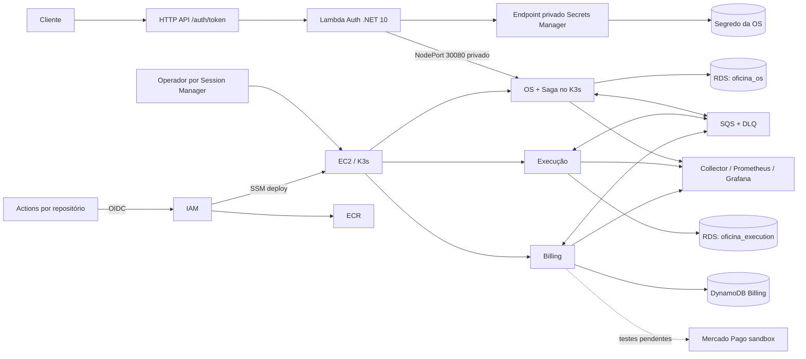
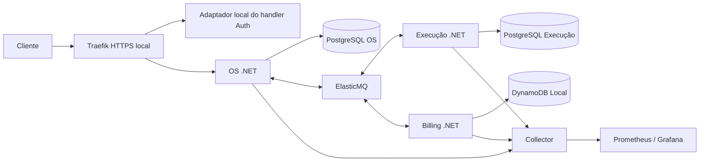

# Arquitetura da demonstração Fase 4

## AWS preparado pelo Terraform

OS é dona do pedido e orquestra a Saga. Execução é dona de catálogo, estoque e reparo. Billing é dono de orçamento e pagamento. Cada serviço grava seus próprios dados; eventos SQS atravessam Outbox/Inbox, com idempotência e compensações. A Lambda consulta a OS por rede privada e lê apenas o segredo da OS via endpoint privado. O security group não abre SSH nem a API da OS ao público. O smoke AWS usa Session Manager e `port-forward` no nó para criar/consultar a OS; somente a HTTP API da Lambda tem URL pública neste desenho.

O webhook real do Mercado Pago exige ingresso HTTPS público para Billing e credenciais de teste; ambos continuam pendentes. Acesso remoto a JWT de cliente e tracking também depende de publicar a rota da OS com TLS. Os manifests e Terraform foram validados localmente, mas a implantação AWS ainda precisa de `plan` revisado, `apply` autorizado e smoke real.

## Execução local comprovada

`scripts/demo-fase4.ps1` verifica localmente abertura de OS, cotação Execução, orçamento Billing, CPF → JWT → tracking, trace distribuído e dashboard. O pagamento no demo local usa provedor simulado. A [matriz de evidências](evidence/phase4-status.md) distingue preparação, execução local e comprovação remota.
