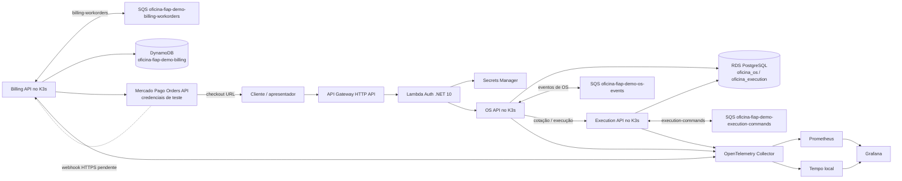

# Arquitetura e recursos

## AWS observado

- Conta `879310855568`, região `us-east-1`.
- EC2 K3s `i-0d52b759881c2b84d`: `running`; SSM `Online`; node `Ready`; K3s `v1.36.6+k3s1`.
- RDS PostgreSQL `oficina-fiap-demo-postgres`: `available`, criptografia habilitada.
- DynamoDB `oficina-fiap-demo-billing`: `ACTIVE`.
- SQS: `oficina-fiap-demo-billing-workorders`, `oficina-fiap-demo-os-events`, `oficina-fiap-demo-execution-commands` e respectivas DLQs.
- ECR: `oficina-fiap-demo-os`, `oficina-fiap-demo-execution`, `oficina-fiap-demo-billing`.
- Lambda `oficina-fiap-demo-auth`: `Active`, `LastUpdateStatus=Successful`, runtime `dotnet10`.
- API de autenticação: [POST /auth/token](https://un67q1d3jk.execute-api.us-east-1.amazonaws.com/auth/token).
- Segredos da aplicação e senha gerenciada do RDS existem no Secrets Manager; valores omitidos.

## Acesso e limites

OS, Billing, Execution, Grafana e Tempo estão em serviços `ClusterIP`; não há URL pública para Grafana nem endpoint público TLS do Billing. O node usa `10.42.0.77`; o CIDR dos pods foi separado do CIDR VPC (`10.244.0.0/16`). Tempo usa armazenamento local `emptyDir` de 1 GiB para esta demonstração, sem criar serviço AWS adicional; os traces não são persistentes após recriação do pod.
