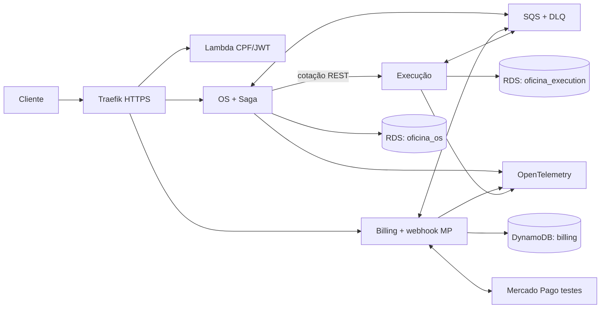

# Plano de implementação — Tech Challenge Fases 3 e 4

Atualizado em 10/11/2026. Estado: **Etapa 1 aprovada; implementação incremental iniciada**. Base analisada: commit `ab3cdb1` da branch `main`. Este documento é a fonte de progresso, decisões, pendências e próximos passos.

## Decisão executiva

Evoluir o monólito .NET existente para três serviços implantáveis, mantendo o repositório atual e seu histórico como **oficina-os** após a extração. Criar **oficina-execution** (PostgreSQL) e **oficina-billing** (DynamoDB), além de **oficina-auth-lambda**, **oficina-k8s-infra** e **oficina-data-infra**. São seis repositórios ao final: três exigidos na Fase 4, mais a separação explícita de Lambda, infraestrutura Kubernetes e banco gerenciado da Fase 3. Cada serviço terá seu Dockerfile, manifests, pipeline, estado de infraestrutura próprio e banco inacessível aos demais. Os repositórios de infraestrutura contêm recursos compartilhados; a divisão não exige seis clusters.

Usar um único cluster **K3s em EC2** para homologação/demonstração de baixo custo, Terraform, um ingresso Traefik, SQS com DLQ, RDS PostgreSQL Single-AZ com *dois databases e usuários distintos* (OS e Execução) e uma tabela DynamoDB de Billing. A instância RDS compartilhada é uma interpretação econômica de “banco próprio”; se a avaliação exigir instâncias físicas distintas, separar em duas instâncias sem alterar os contratos. K3s é Kubernetes, mas uma EC2 não entrega alta disponibilidade: expansão nacional é contexto do desafio, não desempenho comprovado por este ambiente. Para produção real, mudar o perfil de infraestrutura para múltiplos nós e RDS Multi-AZ após medir carga; EKS é opcional e adiciona custo fixo.

**Escolha de persistência:** Billing é majoritariamente novo, com acessos por OS, versão de orçamento e tentativa de pagamento. DynamoDB on-demand exige modelagem por chave, idempotência e operações condicionais, mas evita reescrever a persistência EF Core de catálogo e estoque. Valores monetários em centavos inteiros e moeda BRL. PostgreSQL continua dono das entidades e mapeamentos já existentes.

## Diagnóstico do repositório

| Área | Encontrado | Impacto |
|---|---|---|
| Arquitetura | Quatro projetos em camadas `Domain`, `Application`, `Infrastructure`, `Api`, mas um processo e um `WorkshopDbContext` | Boa base de código, ainda não são microsserviços |
| Domínio | `WorkOrder` contém status, histórico e cálculo; `Customer`, `Vehicle`, `RepairService`, `PartSupply` têm regras/validadores | Copiar/mover para o serviço dono; preservar testes úteis |
| Acoplamento | `IWorkshopRepository` e `WorkOrderApplicationService` concentram cadastro, catálogo, estoque, orçamento e OS | Dividir portas por serviço, substituir transação única por Saga |
| Estoque | Baixa na **abertura** da OS, antes da aprovação; recusa não devolve saldo | Trocar por reserva após aprovação, com compensação e concorrência controlada |
| Status | `ApproveBudget` inicia `InExecution` imediatamente | Introduzir estados intermediários de pagamento/reserva; execução só após confirmação |
| Notificação | SMTP/log após commit; destinatário SMTP de demonstração | Outbox para evento; destinatário real via cadastro e falha sem desfazer operação confirmada |
| Persistência | SQLite local, PostgreSQL em Compose/K8s; `EnsureCreated` por padrão, sem migrations versionadas | Criar migrations e job único de migração; remover seed/demo em Production |
| APIs | Controllers REST e Swagger; tracking anônimo usa CPF/CNPJ na URL | Reaproveitar rotas compatíveis; usar JWT da Lambda para tracking protegido |
| Docker/K8s | Dockerfile multi-stage/non-root; probes, requests/limits e HPA existentes | Adaptar por serviço e criar overlays Production; HPA requer métricas e capacidade real |
| Terraform | Somente cluster local kind | Criar módulos AWS e estados separados; manter kind local |
| CI/CD | Build/test e deploy kind manual; imagem apenas construída | Três pipelines independentes com ECR, qualidade, cobertura e deploy automático |
| Qualidade | 55 testes de domínio e 11 de integração documentados; cobertura de classes críticas, não por serviço; sem BDD ou Sonar | Cobertura >=80% de código de produção **em cada serviço**, BDD completo, quality gates |
| Observabilidade | Healthchecks e `ILogger` sem correlação/tracing/dashboards | Implementar requisitos da Fase 3 e rastreamento distribuído da Fase 4 |
| SDK/runtime | Originalmente `net8.0`, SDK 9.0.313 fixado; máquina tinha apenas 9.0.203 | **Atualizado** para SDK/runtime .NET 10 e pacotes ASP.NET/EF/Npgsql compatíveis; SDK 10.0.403 instalado localmente em `.dotnet_home` (ignorada pelo Git) |

Baseline revalidada em 10/11/2026: antes da migração, 55 testes de domínio e 11 de integração passaram; após a migração para .NET 10, os mesmos 66 passaram. Cobertura histórica crítica confirmada: 87,82% em `Domain.*` e 83,72% no recorte de domínio dos testes de integração. Esses números ainda **não** provam a cobertura de 80% por microsserviço exigida na Fase 4. A primeira tentativa de `dotnet test` falhou por SDK ausente; depois houve incompatibilidade de `Microsoft.AspNetCore.Mvc.Testing` 8 com ASP.NET 10, resolvida atualizando os pacotes. Não há evidência de deploy AWS, integração Mercado Pago, Saga ou Fase 3 implementados.

## Matriz de requisitos e evidências previstas

Legenda: **E** existente, **P** parcial, **A** ausente. “Evidência” descreve o que será gerado/validado, não um resultado já obtido.

| Fase / requisito | Hoje | Implementação necessária | Evidência de validação |
|---|---|---|---|
| F1: abertura, cadastro, orçamento, status, estoque, tracking, métricas | P | Preservar contratos de negócio e distribuir responsabilidades; corrigir reserva/fluxo | BDD ponta a ponta, testes de contrato e Swagger |
| F1: JWT administrativo, CPF/placa, Docker Compose, DDD, cobertura crítica | P | Reusar validadores e Compose; substituir segredo local de produção; atualizar diagramas e cobertura | Testes, Compose, documentação DDD, relatório de cobertura |
| F2: Clean Architecture, status, decisão externa, prioridade da lista | E/P | Manter comportamento público; fazer decisão chegar ao Billing e fila/ordenação na Execução/OS | Regressão HTTP e testes de transição/listagem |
| F2: K8s, HPA, ConfigMap/Secret, Terraform, CI/CD | P | Manifests por serviço, métricas reais, Terraform AWS e deploy automático | `kubectl`/rollout, `terraform validate/plan`, execução Actions |
| F3: gateway e autenticação serverless por CPF | A | Traefik como gateway; Lambda valida CPF, consulta cliente por API interna autenticada, devolve JWT curto; rotas de cliente verificam token | Testes Lambda, fluxo de autenticação, 401/200 e diagrama de sequência |
| F3: banco gerenciado, cluster escalável, IaC | A | RDS PostgreSQL, DynamoDB, K3s/EC2, HPA sujeito à capacidade; módulos Terraform | Plan e smoke AWS em homologação; teste de carga/HPA sem prometer HA |
| F3: quatro tipos de repositório, CI/CD, branches de homologação e produção protegidas | A | Seis repos finais, workflows por repo, ambientes `staging`/`production`, PR obrigatório e checks | URLs, configurações de proteção e runs; configuração remota depende de autorização |
| F3: logs JSON/correlação, latência, CPU/memória, uptime, alertas, dashboards e traces | A/P | OpenTelemetry, coletor, métricas K8s, logs, dashboards/alertas e propagação de trace/contexto | Capturas/links dos dashboards, alerta acionado e trace completo |
| F3: diagramas, RFC/ADR, ER e justificativa do banco | P | Atualizar arquitetura distribuída, sequência auth/OS, ER dos dois SQL e modelo Dynamo | Documentos revisados nos repos |
| F4: >=3 serviços, repos/infra/bancos próprios, SQL+NoSQL, isolamento de dados | A | OS/Execução/Billing, seis repos, dois databases SQL isolados + tabela Dynamo | Repos, manifests, Terraform, testes de permissões/contratos |
| F4: REST quando útil, mensageria assíncrona, Saga e compensações | A | SQS+DLQ, outbox/inbox, orquestração persistida em OS, reservas/estorno/reconciliação | BDD happy path e falhas, mensagens duplicadas, DLQ, trace da Saga |
| F4: integração Mercado Pago | A | Orders API QR dinâmico em ambiente de testes, webhook e consulta de confirmação, reembolso | Teste com credenciais de teste e evidência de pagamento/estorno |
| F4: unitários em todos, BDD completo, >=80% por serviço, Sonar/similar | A/P | Suítes por serviço e gate CI por cobertura integral de produção e qualidade | Relatórios por serviço e quality gate verde |
| F4: CI/CD K8s independente e main protegida | A | GitHub Actions OIDC, ECR, rollout por serviço, proteção de branch | Três runs e configurações GitHub verificadas |
| F4: README/Swagger, vídeo <=15 min, PDF final | A/P | Documentação e roteiro; vídeo e PDF após ambientes e URLs existirem | Links, capturas, documento de entrega |

**Interpretação das fases:** a Fase 4 herda expressamente a observabilidade da Fase 3. O pedido atual também inclui autenticação serverless, gateway, banco gerenciado, Terraform e organização de repositórios da Fase 3; por isso todos estão no escopo. Os exemplos OS/Billing/Execução da Fase 4 são sugeridos, mas combinam com as fronteiras do código. Multi-região, CRUD completo de filiais, EKS e instâncias SQL físicas por serviço não constam como obrigação literal. Adicionar `BranchId` à OS, reserva, cobrança e eventos para preparar múltiplas unidades, sem inventar uma plataforma de filiais.

## Arquitetura-alvo e propriedade dos dados

| Repositório | Responsabilidade | Dados | Código reaproveitado |
|---|---|---|---|
| `oficina-os` (repo atual, histórico mantido) | Clientes, veículos, abertura, status/histórico/tracking, orquestrador Saga | PostgreSQL database `oficina_os` | `Customer`, `Vehicle`, validações, controllers e parte de `WorkOrder`/EF |
| `oficina-execution` | Catálogo de serviços/peças, estoque, reserva, diagnóstico, fila/reparo/finalização | PostgreSQL database `oficina_execution` | `RepairService`, `PartSupply`, seus controllers, mapeamentos EF e testes |
| `oficina-billing` | Orçamentos versionados, aprovação/recusa, pagamento, webhook/reconciliação/estorno Mercado Pago | DynamoDB tabela de Billing | Cálculo de linhas monetárias; novas regras de pagamentos |
| `oficina-auth-lambda` | Validar CPF, consultar cliente, emitir JWT do cliente | Sem banco próprio; consulta API interna do OS | `DocumentValidator` e validações |
| `oficina-k8s-infra` | Terraform do cluster/gateway/observabilidade, namespaces/ingresso | Estado Terraform remoto | Partes de `infra/terraform` e `k8s/` como referência |
| `oficina-data-infra` | Terraform RDS, DynamoDB, SQS/DLQ, ECR, IAM, segredos | Estado Terraform remoto | Configuração Postgres atual como referência |

Gateway encaminha APIs e webhook por um único domínio HTTPS. CPF sozinho não comprova identidade; a Lambda atende ao enunciado acadêmico, com rate limit, JWT curto e respostas sem enumeração de clientes. Para uso real, acrescentar segundo fator antes de expor dados pessoais. Rotas administrativas continuam separadas das rotas de cliente; retirar senha `admin` de Production. A Lambda **não** acessa diretamente o banco OS: usa endpoint interno de consulta, preservando a propriedade de dados.

Consulta síncrona pontual: OS pede cotação batch ao catálogo da Execução **antes** de persistir a abertura. Salva snapshot imutável de nome/preço/quantidade; Billing cria orçamento versionado a partir desse snapshot. Alterações futuras do catálogo não alteram orçamento aprovado. Demais mudanças de estado trafegam por eventos/comandos SQS versionados com `eventId`, `correlationId`, `workOrderId`, `branchId` e `occurredAt`.

## Saga, dados e falhas

**Orquestração em OS**, com estado persistido e timeout/reconciliação; evita criar um quarto serviço. O status público permanece alinhado aos seis estados acadêmicos, com subestados internos `BudgetPending`, `AwaitingApproval`, `StockReserved`, `PaymentPending`, `PaymentConfirmed`, `ExecutionQueued`, `Compensating`, `ManualReview`.

1. Abrir OS: cotação batch, gravar OS `Received` + Outbox em transação local. Falha de cotação impede gravação.
2. Billing cria orçamento e avisa OS; OS envia orçamento e aguarda decisão. Recusa encerra/revisa a tentativa sem baixa de estoque.
3. Aprovação dispara reserva idempotente em Execução (transação SQL com quantidade suficiente e versão). Falha de reserva volta para revisão/cancelamento e registra motivo.
4. Reserva confirmada permite Billing criar uma tentativa de pagamento QR dinâmico Mercado Pago com chave de idempotência estável. Webhook é apenas sinal; Billing consulta a order no provedor e confere valor, referência e estado antes de confirmar.
5. Pagamento confirmado libera a execução. Execução confirma início e conclusão; OS atualiza histórico, calcula tempos e permite entrega.
6. Timeout/recusa de pagamento: reconciliar a order; se efetivamente não paga, cancelar tentativa e liberar reserva. Erro definitivo antes do início após pagamento: solicitar estorno, confirmar resultado e liberar reserva. Se o reparo já começou, marcar `ManualReview` para tratamento operacional; um serviço físico não pode ser desfeito por software.

Outbox transacional em OS/Execução; em Billing, `TransactWriteItems` grava estado + Inbox/Outbox. Workers enviam depois do commit; consumidores toleram duplicação, eventos fora de ordem e reprocessamento. SQS com DLQ e alarmes; ordem de eventos por OS deve ser controlada por versão/estado, não por pressupor entrega exatamente uma vez. Timeout do Mercado Pago nunca vira nova cobrança automática. O teste de falha deverá mostrar compensação de reserva/estorno ou encaminhamento `ManualReview` verificável.

## AWS: perfil econômico e custo mensal preliminar

Hipótese original: `us-east-1`, 730 horas/mês, homologação 24x7, baixa carga, um nó K3s x86 com 2 vCPU/8 GiB, RDS PostgreSQL Single-AZ pequeno, 20–30 GiB de discos, tráfego e logs baixos. **Decisão posterior do usuário: cluster ligado apenas por aproximadamente 1 hora para a apresentação.** O desenvolvimento e BDD serão locais. Estimativas de planejamento, não cotação; validar região/tamanhos no AWS Pricing Calculator antes de aplicar. Valores em USD, sem impostos, taxas Mercado Pago, saída de dados, domínio ou descontos/free tier.

| Item | Estimativa/mês | Decisão de custo |
|---|---:|---|
| EC2 K3s 2 vCPU/8 GiB | ~US$61 | Um cluster compartilhado; desligar ambiente de homologação fora da demo quando possível |
| RDS PostgreSQL Single-AZ pequeno + armazenamento | ~US$15–30 | Dois databases/usuários sem cruzar dados; backup limitado e restauração testada |
| EBS gp3 30 GiB + IPv4 público | ~US$6 | Um ingresso; evitar load balancer por serviço |
| DynamoDB on-demand, SQS/DLQ, ECR, CloudWatch | ~US$5–20 em baixa carga | Cobrança variável; retenção curta e alarmes de orçamento |
| **Total indicativo 24x7** | **~US$87–117/mês** | Região Brasil, NAT Gateway, alto volume de logs e múltiplos nós podem elevar bastante |

**Cenário aprovado de demonstração (~1h):** computação EC2 + RDS custa aproximadamente **US$0,10–0,20 por hora** usando os tamanhos acima; somar EBS, snapshots, armazenamento RDS, IPv4 enquanto alocado, ECR, logs e tráfego. Se os volumes/BD permanecerem criados por um mês, a conta **não** se reduz a 1/730 do total: um orçamento conservador é **~US$8–25 no mês de demo**, sujeito ao tempo real de provisionamento, armazenamento e serviços variáveis. Reservar horas extras para criação, migração, smoke e vídeo; uma hora literal pode ser curta para RDS e cluster iniciarem. Nenhum `apply`, stop ou destroy será executado sem autorização específica.

EKS acrescenta **US$0,10/h (~US$73/mês se 24x7)** só pelo control plane em suporte padrão, além de workers e rede; não é obrigatório no enunciado. NAT Gateway traz custo horário e por GB, então o perfil acadêmico usa uma EC2 pública com restrições de rede/TLS, banco privado e sem NAT. DynamoDB e SQS são cobrados pelo uso. RDS gerenciado é mantido por ser exigência da Fase 3. Single node e Single-AZ são limites explícitos de disponibilidade; não prometem tolerância a falha da zona. RDS pode ficar parado por no máximo sete dias consecutivos antes de reinício automático, e armazenamento/backup continuam cobrando. Portanto, o runbook da demo deve prever desligamento e eventual remoção **autorizada** dos recursos depois da apresentação. Configurar AWS Budget antes de qualquer apply.

Fontes de preço e tecnologia consultadas em 10/11/2026: [EKS](https://aws.amazon.com/eks/pricing/), [EC2](https://aws.amazon.com/ec2/pricing/on-demand/), [RDS PostgreSQL](https://aws.amazon.com/rds/postgresql/pricing/), [EBS](https://aws.amazon.com/ebs/pricing/), [VPC/IPv4/NAT](https://aws.amazon.com/vpc/pricing/), [DynamoDB](https://aws.amazon.com/dynamodb/pricing/), [SQS](https://aws.amazon.com/sqs/pricing/), [mínimos K3s](https://docs.k3s.io/installation/requirements) e [suporte .NET](https://devblogs.microsoft.com/dotnet/dotnet-8-9-end-of-support/). Confirmar preços no Calculator para a conta/região reais.

## Migração incremental e critérios de saída

| Ordem | Entrega | Testes/critério de saída | Estado |
|---|---|---|---|
| 0 | Aprovar arquitetura, região, repositórios, orçamento e política de homologação | Usuário autorizou implementação em etapas e cluster ~1h | **Concluído** |
| 1 | Estabelecer baseline local, alinhar SDK/runtime .NET 10 e Compose; registrar regressões | 66 testes baseline verdes, cobertura crítica 87,82%/83,72%, `docker compose config --quiet` e build Docker .NET 10 passaram | **Concluído** |
| 2 | Preparar contratos de eventos/HTTP, `BranchId`, estados e migrations; criar repositórios preservando Git atual | `docs/contracts-phase4.md`, `BranchId` opcional em OS/API, migration inicial PostgreSQL versionada e SQL idempotente aplicado duas vezes em PostgreSQL 16 descartável; 58 testes de domínio + 11 de integração verdes. Extração e repos separados ainda pendentes | **Em andamento** |
| 3 | Extrair Execução com catálogo/estoque e reserva; OS mantém clientes/veículos/status/Saga | App `services/Oficina.Execution` compila isoladamente, banco e migration PostgreSQL próprios, Dockerfile, Compose e 3 testes. Smoke HTTP com PostgreSQL: ready, cotação R$125, reserva e liberação; SQL da migration aplicado duas vezes. OS já consome cotação HTTP batch opcional, valida o snapshot e não baixa estoque local nesse modo; 4 testes novos de integração/contrato. Dois testes PostgreSQL reais comprovaram que reservas concorrentes não vendem saldo além do disponível. Integração SQS, fila de reparos e repositório Git próprio pendentes | **Em andamento** |
| 4 | Criar Billing DynamoDB e adaptador Mercado Pago de testes; revisar fluxo de aprovação | App `services/Oficina.Billing` compila isoladamente, DynamoDB próprio, orçamento versionado em centavos e decisão condicional, Dockerfile/Compose, 3 testes unitários. Smoke DynamoDB Local: ready, criação e decisão repetidas idempotentes. Mercado Pago, webhook, pagamento, estorno, SQS e repositório Git próprio pendentes | **Em andamento** |
| 5 | Implementar SQS, Outbox/Inbox, Saga e compensações; Compose local com broker compatível ou adaptador de mensagens testável | BDD fim a fim e falhas, DLQ, contratos, 80% por serviço | Pendente |
| 6 | Lambda CPF/JWT, gateway, rotas protegidas; telemetria F3/F4 | Testes de autenticação, logs/traces/dashboards/alertas | Pendente |
| 7 | Terraform AWS, K3s, RDS/Dynamo/SQS/IAM/segredos, pipelines OIDC/ECR/deploy e proteção de branches | Três pipelines independentes de serviços; CI/CD de Lambda e dos dois repos de infraestrutura; `terraform validate/plan`, qualidade, rollout/smoke; apply só autorizado | Pendente |
| 8 | README por repo, diagramas, ADR/RFC/ER, evidências, roteiro/vídeo/PDF final | Matriz final com links/capturas reais e validação do vídeo <=15 min | Pendente |

Implementação local e testes não dependem de criar recursos pagos. Repositórios remotos, infraestrutura AWS, segredos externos e gravação de vídeo exigem insumos/autorização no momento apropriado. Não registrar “atendido” sem evidência executada.

## Riscos e decisões pendentes

- **Dependência do SDK:** .NET 10.0.403 instalado localmente em `.dotnet_home/sdk10` e `global.json` alinhado. Em outra máquina, instalar o mesmo SDK; Dockerfile usa SDK 10 e a imagem local `oficina-mvp-api:net10` foi construída. Os futuros workflows usarão SDK 10.
- **Transição controlada:** `ApproveBudgetForPayment`, reserva, confirmação de pagamento e início de execução são métodos de domínio novos, ainda não chamados pelos controllers. O endpoint legado `approve-budget` continua iniciando execução para preservar a suíte antiga enquanto Billing/Execução não existem. Antes do corte final, substituir essa rota pelo fluxo Saga, remover o caminho legado e atualizar testes; não declarar requisito distribuído atendido antes disso. O novo campo `ProcessState` requer migration para bancos persistentes.
- **Extração Execução:** código copiado para `services/Oficina.Execution` sem dependência de projetos do monólito. Enquanto houver duas implementações do catálogo, o monólito ainda usa seu banco antigo; não apontar os dois serviços ao mesmo database. Com `Execution:BaseUrl` e `Execution:InternalToken` configurados na API OS, a abertura da OS pede cotação batch a Execução, grava snapshot de preços e não baixa o estoque local. Sem essas configurações, o fluxo legado permanece ativo para desenvolvimento e regressão. A cotação não reserva estoque; essa parte depende da Saga. O serviço novo usa `X-Internal-Token` local; substituir por identidade entre serviços/IAM no deploy. Reserva usa token de concorrência no saldo e chave de idempotência; teste PostgreSQL confirmou rollback da reserva perdedora. Mensageria e tentativa/reconciliação da mesma chave ainda pendentes.
- **Extração Billing:** `services/Oficina.Billing` é independente e usa tabela DynamoDB própria. A aprovação de orçamento implementada ali ainda não chega à OS, e nenhum pagamento real foi iniciado. A tabela é criada automaticamente apenas em Development local; Terraform será dono da tabela AWS. Smoke no DynamoDB Local validou idempotência simples; adicionar testes automatizados de concorrência/conflito, adaptador Mercado Pago de testes e inbox/outbox antes de ativar a Saga.
- **Migrations por provider:** a migration inicial em `src/OficinaMvp.Infrastructure/Persistence/Migrations` foi gerada para PostgreSQL (colunas `uuid`, `character varying`) e seu SQL idempotente foi aplicado duas vezes em PostgreSQL 16 local. Testes de integração SQLite continuam com `EnsureCreated`, pois migrations EF Core geradas para PostgreSQL não são portáveis para SQLite. O fluxo Production usa `MigrateAsync`; bancos criados antes com `EnsureCreated` não têm histórico de migrations e precisarão de migração de dados/estado explícita. Não apontar Production para um desses bancos sem essa etapa.
- **Domínio:** a aprovação hoje inicia execução e o estoque baixa antes de pagar; atualizar invariantes e testes com estados intermediários.
- **Dinheiro e webhook:** integração real de testes com Mercado Pago precisa de credenciais e URL HTTPS de callback. Para QR, a documentação atual prevê Orders API, idempotência e consulta de confirmação; notificações QR têm restrições específicas de assinatura. Referências: [criar order](https://www.mercadopago.com.br/developers/pt/reference/in-person-payments/qr-code/orders/create-order/post), [processamento QR](https://www.mercadopago.com.br/developers/pt/docs/qr-code/payment-processing), [teste](https://www.mercadopago.com.br/developers/pt/docs/qr-code/test-integration/test-purchase), [webhooks](https://www.mercadopago.com.br/developers/en/docs/qr-code/additional-content/your-integrations/notifications/webhooks).
- **IAM em K3s:** role de EC2 compartilhada entre pods não dá privilégio mínimo por serviço. Usar credenciais temporárias por workload/serviço ou proxy de identidade com políticas separadas; validar solução no piloto antes de deploy. EKS Pod Identity é opção mais simples operacionalmente com custo maior. Não embutir chaves AWS em Secrets Kubernetes.
- **ECR em K3s:** credenciais de pull expiram; configurar credential provider/renovação antes de aceitar o deploy automático.
- **Qualidade:** 80% por serviço inclui Application/Infrastructure/API conforme regra acadêmica; exclusões apenas de código gerado, justificadas. Sem “testar o próprio mock”.
- **Observabilidade:** retenção/volume de logs e traces deve ser limitado; métricas de latência, CPU/memória, uptime, falhas de OS, volume diário, tempo por status e erros de integração precisam de dashboards e alerta demonstrável.
- **Segurança e custo:** `main` protegida e OIDC requerem configuração GitHub/AWS; não provisionar nem publicar sem autorização explícita.

## Próximo passo

O commit intermediário `551053c` (`feat: iniciar arquitetura distribuída com Execução e Billing`) preserva o marco anterior. O incremento seguinte adicionou cotação HTTP opcional OS→Execução, snapshot validado e testes; está no working tree para revisão/commit futuro.

Continuar ordens 3–5: conectar OS↔Execução/Billing por SQS, implementar pagamentos Mercado Pago em testes, compensações e BDD. Os diretórios `services/*` ainda estão no repositório atual para facilitar a extração; separar em repositórios Git independentes preservando o histórico antes do deploy. Antes de qualquer `terraform apply`, criação de recursos pagos ou publicação de repositórios, apresentar o plano concreto desses atos para autorização explícita.
