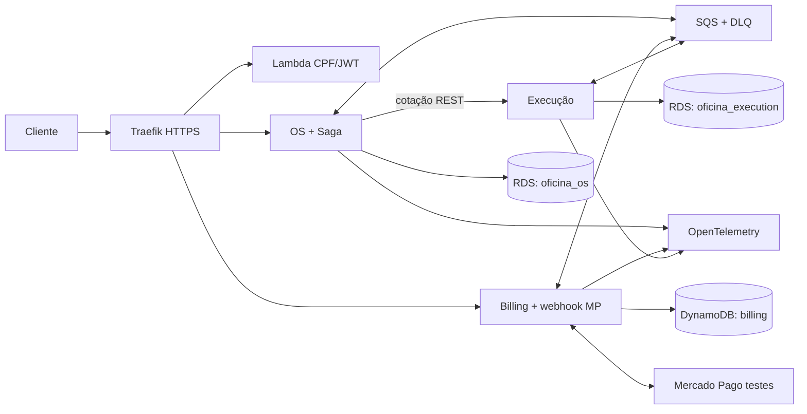

# Plano de implementação — Tech Challenge Fases 3 e 4

Atualizado em 16/11/2026. Estado: **plano acelerado de dois dias em execução**. O plano amplo abaixo permanece como referência; a seção seguinte define a ordem vigente. Este documento é a fonte de progresso, decisões, pendências e próximos passos.

## Plano vigente: entrega demonstrável em dois dias

**Objetivo:** mostrar em 15 minutos CI/CD no GitHub Actions e, se os pré-requisitos de conta e autorização estiverem prontos, três serviços rodando em K3s/AWS por uma janela curta. A demonstração Docker já validada complementa a prova de Saga, autenticação e observabilidade. Pagamento/estorno simulado será identificado como tal. O plano acadêmico permanece, mas só itens verificados serão apresentados como concluídos.

| Ordem / prazo alvo | Responsável | Ação e como verificar |
|---|---|---|
| 1. Preparado localmente | Assistente | Workflows próprios para OS, Execução, Billing, Auth e duas infraestruturas; três imagens Docker, ZIP Lambda, seis clones e manifests por serviço preparados. Testes e gates locais passaram; execução remota dos workflows ainda pendente. |
| 2. Dia 1, 1–2 h | Usuário | Confirmar conta/região AWS, limite de gasto, acesso GitHub e autorizar explicitamente publicação dos repositórios e criação dos recursos pagos. Criar AWS Budget com alerta baixo antes de `apply`; enviar apenas IDs/nomes, nunca credenciais no chat ou Git. |
| 3. Terraform preparado | Assistente | EC2/K3s de um nó, ECR, RDS PostgreSQL com dois bancos, DynamoDB, SQS/DLQ, IAM/OIDC, Lambda e segredos. Dados e K3s têm estados separados; `fmt` e `validate` passaram em ambos. `plan` real e revisão de custo aguardam conta, região, bucket e owner GitHub. |
| 4. Extração local pronta | Usuário + assistente | Seis clones preservam histórico, branch `main` e workflow próprio. Publicar após autorização, ativar Actions e branch protection; confirmar runs remotos dos três serviços, Auth e duas infraestruturas. |
| 5. Dia 2, 3–5 h | Assistente, após autorização | Aplicar Terraform, publicar imagens no ECR via OIDC, implantar em K3s via Actions, fazer smoke de `/health/ready`, `kubectl get pods,hpa` e registrar evidência no console AWS/Actions. Não habilitar endpoint público sem TLS/controle de acesso. |
| 6. Dia 2, 1–2 h | Usuário + assistente | Ensaiar demonstração de 15 min, salvar capturas e desligar/remover recursos conforme autorização explícita. Verificar cobrança residual de EBS/RDS/IPv4/ECR. |

**Ordem crítica:** conta/orçamento → Terraform validado → autorização de `apply` e publicação → IAM OIDC/ECR → três imagens → K3s + bancos/filas → deploy Actions → smoke/evidências → desligamento. Preparar AWS leva mais que uma hora; limitar a **janela de apresentação com cluster ligado** a cerca de uma hora, prevendo provisionamento e smoke antes. O orçamento anterior de US$8–25 para um mês de demonstração é apenas estimativa histórica: revisar preços na região escolhida e o `terraform plan` antes de aplicar. RDS, armazenamento, IPv4, snapshots, ECR e logs podem gerar custo mesmo com EC2 parada.

**Trabalho manual do usuário, na ordem:** (1) confirmar acesso temporário à conta AWS e repositórios GitHub; (2) criar AWS Budget/alerta e escolher região; (3) autorizar criação/publicação dos seis repositórios exigidos pela combinação das Fases 3 e 4 e fornecer nomes/owner; (4) após receber o Terraform plan, autorizar `apply` com valor e janela; (5) configurar credenciais Mercado Pago **de testes** em Secrets Manager somente se quiser demonstrar pagamento real; (6) na apresentação, abrir as telas Actions, EC2/RDS/DynamoDB/SQS e K3s preparadas; (7) autorizar desligamento/destroy e conferir Cost Explorer no dia seguinte. Confirmar `soat-architecture` como colaborador nos seis repositórios antes da entrega. O procedimento detalhado e as verificações estão em `docs/runbooks/preparacao-github-aws.md`. O assistente prepara código, infraestrutura e comandos antes de cada ato autorizado. Nenhuma chave estática AWS será guardada no GitHub; usar OIDC.

**Prioridade para nota:** (1) três serviços, bancos separados e Saga/compensação funcionando; (2) três pipelines com testes e imagem, deploy Kubernetes e recursos AWS visíveis; (3) JWT via Lambda, gateway, tracing/métricas; (4) qualidade, BDD, segurança e custo; (5) integração Mercado Pago em sandbox, se credenciais e callback forem viáveis. As Fases 3 e 4 juntas exigem seis repositórios físicos: três serviços, Auth Lambda e duas infraestruturas. Publicação, branch protection e colaborador `soat-architecture` exigem a etapa manual remota. Nunca afirmar requisitos não comprovados.

**Contingência se acesso/autorização AWS não chegar a tempo:** executar `deploy-kind.yml` no GitHub Actions para mostrar CI/CD e Kubernetes reais no runner, `phase4-local.yml` para Saga/BDD, e o demo Docker para APIs/observabilidade. Mostrar Terraform `validate/plan` quando disponível e declarar que AWS não foi aplicado. Isso preserva uma demonstração honesta, embora com lacuna acadêmica.

## Decisão executiva

Evoluir o monólito .NET existente para três serviços implantáveis, mantendo o repositório atual e seu histórico como **oficina-os** após a extração. Criar **oficina-execution** (PostgreSQL) e **oficina-billing** (DynamoDB), além de **oficina-auth-lambda**, **oficina-k8s-infra** e **oficina-data-infra**. São seis repositórios ao final: três exigidos na Fase 4, mais a separação explícita de Lambda, infraestrutura Kubernetes e banco gerenciado da Fase 3. Cada serviço terá seu Dockerfile, manifests, pipeline, estado de infraestrutura próprio e banco inacessível aos demais. Os repositórios de infraestrutura contêm recursos compartilhados; a divisão não exige seis clusters.

Usar um único cluster **K3s em EC2** para homologação/demonstração de baixo custo, Terraform, um ingresso Traefik, SQS com DLQ, RDS PostgreSQL Single-AZ com *dois databases e usuários distintos* (OS e Execução) e uma tabela DynamoDB de Billing. A instância RDS compartilhada é uma interpretação econômica de “banco próprio”; se a avaliação exigir instâncias físicas distintas, separar em duas instâncias sem alterar os contratos. K3s é Kubernetes, mas uma EC2 não entrega alta disponibilidade: expansão nacional é contexto do desafio, não desempenho comprovado por este ambiente. Para produção real, mudar o perfil de infraestrutura para múltiplos nós e RDS Multi-AZ após medir carga; EKS é opcional e adiciona custo fixo.

**Escolha de persistência:** Billing é majoritariamente novo, com acessos por OS, versão de orçamento e tentativa de pagamento. DynamoDB on-demand exige modelagem por chave, idempotência e operações condicionais, mas evita reescrever a persistência EF Core de catálogo e estoque. Valores monetários em centavos inteiros e moeda BRL. PostgreSQL continua dono das entidades e mapeamentos já existentes.

## Diagnóstico do repositório

| Área | Encontrado | Impacto |
|---|---|---|
| Arquitetura | Quatro projetos em camadas `Domain`, `Application`, `Infrastructure`, `Api`, mas um processo e um `WorkshopDbContext` | Boa base de código, ainda não são microsserviços |
| Domínio | `WorkOrder` contém status, histórico e cálculo; `Customer`, `Vehicle`, `RepairService`, `PartSupply` têm regras/validadores | Copiar/mover para o serviço dono; preservar testes úteis |
| Acoplamento | `IWorkshopRepository` e `WorkOrderApplicationService` concentram cadastro, catálogo, estoque, orçamento e OS | Dividir portas por serviço, substituir transação única por Saga |
| Estoque | Baixa na **abertura** da OS, antes da aprovação; recusa não devolve saldo | Trocar por reserva após aprovação, com compensação e concorrência controlada |
| Status | `ApproveBudget` inicia `InExecution` imediatamente | Introduzir estados intermediários de pagamento/reserva; execução só após confirmação |
| Notificação | SMTP/log após commit; destinatário SMTP de demonstração | Outbox para evento; destinatário real via cadastro e falha sem desfazer operação confirmada |
| Persistência | SQLite local, PostgreSQL em Compose/K8s; `EnsureCreated` por padrão, sem migrations versionadas | Criar migrations e job único de migração; remover seed/demo em Production |
| APIs | Controllers REST e Swagger; tracking anônimo usa CPF/CNPJ na URL | Reaproveitar rotas compatíveis; usar JWT da Lambda para tracking protegido |
| Docker/K8s | Dockerfile multi-stage/non-root; probes, requests/limits e HPA existentes | Adaptar por serviço e criar overlays Production; HPA requer métricas e capacidade real |
| Terraform | Somente cluster local kind | Criar módulos AWS e estados separados; manter kind local |
| CI/CD | Build/test e deploy kind manual; imagem apenas construída | Três pipelines independentes com ECR, qualidade, cobertura e deploy automático |
| Qualidade | 55 testes de domínio e 11 de integração documentados; cobertura de classes críticas, não por serviço; sem BDD ou Sonar | Cobertura >=80% de código de produção **em cada serviço**, BDD completo, quality gates |
| Observabilidade | Healthchecks e `ILogger` sem correlação/tracing/dashboards | Implementar requisitos da Fase 3 e rastreamento distribuído da Fase 4 |
| SDK/runtime | Originalmente `net8.0`, SDK 9.0.313 fixado; máquina tinha apenas 9.0.203 | **Atualizado** para SDK/runtime .NET 10 e pacotes ASP.NET/EF/Npgsql compatíveis; SDK 10.0.403 instalado localmente em `.dotnet_home` (ignorada pelo Git) |

Baseline revalidada em 10/11/2026: antes da migração, 55 testes de domínio e 11 de integração passaram; após a migração para .NET 10, os mesmos 66 passaram. Cobertura histórica crítica confirmada: 87,82% em `Domain.*` e 83,72% no recorte de domínio dos testes de integração. Esses números ainda **não** provam a cobertura de 80% por microsserviço exigida na Fase 4. A primeira tentativa de `dotnet test` falhou por SDK ausente; depois houve incompatibilidade de `Microsoft.AspNetCore.Mvc.Testing` 8 com ASP.NET 10, resolvida atualizando os pacotes. Não há evidência de deploy AWS, integração Mercado Pago, Saga ou Fase 3 implementados.

## Matriz de requisitos e evidências previstas

Legenda: **E** existente, **P** parcial, **A** ausente. “Evidência” descreve o que será gerado/validado, não um resultado já obtido.

| Fase / requisito | Hoje | Implementação necessária | Evidência de validação |
|---|---|---|---|
| F1: abertura, cadastro, orçamento, status, estoque, tracking, métricas | P | Preservar contratos de negócio e distribuir responsabilidades; corrigir reserva/fluxo | BDD ponta a ponta, testes de contrato e Swagger |
| F1: JWT administrativo, CPF/placa, Docker Compose, DDD, cobertura crítica | P | Reusar validadores e Compose; substituir segredo local de produção; atualizar diagramas e cobertura | Testes, Compose, documentação DDD, relatório de cobertura |
| F2: Clean Architecture, status, decisão externa, prioridade da lista | E/P | Manter comportamento público; fazer decisão chegar ao Billing e fila/ordenação na Execução/OS | Regressão HTTP e testes de transição/listagem |
| F2: K8s, HPA, ConfigMap/Secret, Terraform, CI/CD | P | Manifests por serviço, métricas reais, Terraform AWS e deploy automático | `kubectl`/rollout, `terraform validate/plan`, execução Actions |
| F3: gateway e autenticação serverless por CPF | A | Traefik como gateway; Lambda valida CPF, consulta cliente por API interna autenticada, devolve JWT curto; rotas de cliente verificam token | Testes Lambda, fluxo de autenticação, 401/200 e diagrama de sequência |
| F3: banco gerenciado, cluster escalável, IaC | A | RDS PostgreSQL, DynamoDB, K3s/EC2, HPA sujeito à capacidade; módulos Terraform | Plan e smoke AWS em homologação; teste de carga/HPA sem prometer HA |
| F3: quatro tipos de repositório, CI/CD, branches de homologação e produção protegidas | A | Seis repos finais, workflows por repo, ambientes `staging`/`production`, PR obrigatório e checks | URLs, configurações de proteção e runs; configuração remota depende de autorização |
| F3: logs JSON/correlação, latência, CPU/memória, uptime, alertas, dashboards e traces | A/P | OpenTelemetry, coletor, métricas K8s, logs, dashboards/alertas e propagação de trace/contexto | Capturas/links dos dashboards, alerta acionado e trace completo |
| F3: diagramas, RFC/ADR, ER e justificativa do banco | P | Atualizar arquitetura distribuída, sequência auth/OS, ER dos dois SQL e modelo Dynamo | Documentos revisados nos repos |
| F4: >=3 serviços, repos/infra/bancos próprios, SQL+NoSQL, isolamento de dados | A | OS/Execução/Billing, seis repos, dois databases SQL isolados + tabela Dynamo | Repos, manifests, Terraform, testes de permissões/contratos |
| F4: REST quando útil, mensageria assíncrona, Saga e compensações | A | SQS+DLQ, outbox/inbox, orquestração persistida em OS, reservas/estorno/reconciliação | BDD happy path e falhas, mensagens duplicadas, DLQ, trace da Saga |
| F4: integração Mercado Pago | A | Orders API QR dinâmico em ambiente de testes, webhook e consulta de confirmação, reembolso | Teste com credenciais de teste e evidência de pagamento/estorno |
| F4: unitários em todos, BDD completo, >=80% por serviço, Sonar/similar | A/P | Suítes por serviço e gate CI por cobertura integral de produção e qualidade | Relatórios por serviço e quality gate verde |
| F4: CI/CD K8s independente e main protegida | A | GitHub Actions OIDC, ECR, rollout por serviço, proteção de branch | Três runs e configurações GitHub verificadas |
| F4: README/Swagger, vídeo <=15 min, PDF final | A/P | Documentação e roteiro; vídeo e PDF após ambientes e URLs existirem | Links, capturas, documento de entrega |

**Interpretação das fases:** a Fase 4 herda expressamente a observabilidade da Fase 3. O pedido atual também inclui autenticação serverless, gateway, banco gerenciado, Terraform e organização de repositórios da Fase 3; por isso todos estão no escopo. Os exemplos OS/Billing/Execução da Fase 4 são sugeridos, mas combinam com as fronteiras do código. Multi-região, CRUD completo de filiais, EKS e instâncias SQL físicas por serviço não constam como obrigação literal. Adicionar `BranchId` à OS, reserva, cobrança e eventos para preparar múltiplas unidades, sem inventar uma plataforma de filiais.

## Arquitetura-alvo e propriedade dos dados

| Repositório | Responsabilidade | Dados | Código reaproveitado |
|---|---|---|---|
| `oficina-os` (repo atual, histórico mantido) | Clientes, veículos, abertura, status/histórico/tracking, orquestrador Saga | PostgreSQL database `oficina_os` | `Customer`, `Vehicle`, validações, controllers e parte de `WorkOrder`/EF |
| `oficina-execution` | Catálogo de serviços/peças, estoque, reserva, diagnóstico, fila/reparo/finalização | PostgreSQL database `oficina_execution` | `RepairService`, `PartSupply`, seus controllers, mapeamentos EF e testes |
| `oficina-billing` | Orçamentos versionados, aprovação/recusa, pagamento, webhook/reconciliação/estorno Mercado Pago | DynamoDB tabela de Billing | Cálculo de linhas monetárias; novas regras de pagamentos |
| `oficina-auth-lambda` | Validar CPF, consultar cliente, emitir JWT do cliente | Sem banco próprio; consulta API interna do OS | `DocumentValidator` e validações |
| `oficina-k8s-infra` | Terraform do cluster/gateway/observabilidade, namespaces/ingresso | Estado Terraform remoto | Partes de `infra/terraform` e `k8s/` como referência |
| `oficina-data-infra` | Terraform RDS, DynamoDB, SQS/DLQ, ECR, IAM, segredos | Estado Terraform remoto | Configuração Postgres atual como referência |

Gateway encaminha APIs e webhook por um único domínio HTTPS. CPF sozinho não comprova identidade; a Lambda atende ao enunciado acadêmico, com rate limit, JWT curto e respostas sem enumeração de clientes. Para uso real, acrescentar segundo fator antes de expor dados pessoais. Rotas administrativas continuam separadas das rotas de cliente; retirar senha `admin` de Production. A Lambda **não** acessa diretamente o banco OS: usa endpoint interno de consulta, preservando a propriedade de dados.

Consulta síncrona pontual: OS pede cotação batch ao catálogo da Execução **antes** de persistir a abertura. Salva snapshot imutável de nome/preço/quantidade; Billing cria orçamento versionado a partir desse snapshot. Alterações futuras do catálogo não alteram orçamento aprovado. Demais mudanças de estado trafegam por eventos/comandos SQS versionados com `eventId`, `correlationId`, `workOrderId`, `branchId` e `occurredAt`.

## Saga, dados e falhas

**Orquestração em OS**, com estado persistido e timeout/reconciliação; evita criar um quarto serviço. O status público permanece alinhado aos seis estados acadêmicos, com subestados internos `BudgetPending`, `AwaitingApproval`, `StockReserved`, `PaymentPending`, `PaymentConfirmed`, `ExecutionQueued`, `Compensating`, `ManualReview`.

1. Abrir OS: cotação batch, gravar OS `Received` + Outbox em transação local. Falha de cotação impede gravação.
2. Billing cria orçamento e avisa OS; OS envia orçamento e aguarda decisão. Recusa encerra/revisa a tentativa sem baixa de estoque.
3. Aprovação dispara reserva idempotente em Execução (transação SQL com quantidade suficiente e versão). Falha de reserva volta para revisão/cancelamento e registra motivo.
4. Reserva confirmada permite Billing criar uma tentativa de pagamento QR dinâmico Mercado Pago com chave de idempotência estável. Webhook é apenas sinal; Billing consulta a order no provedor e confere valor, referência e estado antes de confirmar.
5. Pagamento confirmado libera a execução. Execução confirma início e conclusão; OS atualiza histórico, calcula tempos e permite entrega.
6. Timeout/recusa de pagamento: reconciliar a order; se efetivamente não paga, cancelar tentativa e liberar reserva. Erro definitivo antes do início após pagamento: solicitar estorno, confirmar resultado e liberar reserva. Se o reparo já começou, marcar `ManualReview` para tratamento operacional; um serviço físico não pode ser desfeito por software.

Outbox transacional em OS/Execução; em Billing, `TransactWriteItems` grava estado + Inbox/Outbox. Workers enviam depois do commit; consumidores toleram duplicação, eventos fora de ordem e reprocessamento. SQS com DLQ e alarmes; ordem de eventos por OS deve ser controlada por versão/estado, não por pressupor entrega exatamente uma vez. Timeout do Mercado Pago nunca vira nova cobrança automática. O teste de falha deverá mostrar compensação de reserva/estorno ou encaminhamento `ManualReview` verificável.

## AWS: perfil econômico e custo mensal preliminar

Hipótese original: `us-east-1`, 730 horas/mês, homologação 24x7, baixa carga, um nó K3s x86 com 2 vCPU/8 GiB, RDS PostgreSQL Single-AZ pequeno, 20–30 GiB de discos, tráfego e logs baixos. **Decisão posterior do usuário: cluster ligado apenas por aproximadamente 1 hora para a apresentação.** O desenvolvimento e BDD serão locais. Estimativas de planejamento, não cotação; validar região/tamanhos no AWS Pricing Calculator antes de aplicar. Valores em USD, sem impostos, taxas Mercado Pago, saída de dados, domínio ou descontos/free tier.

| Item | Estimativa/mês | Decisão de custo |
|---|---:|---|
| EC2 K3s 2 vCPU/8 GiB | ~US$61 | Um cluster compartilhado; desligar ambiente de homologação fora da demo quando possível |
| RDS PostgreSQL Single-AZ pequeno + armazenamento | ~US$15–30 | Dois databases/usuários sem cruzar dados; backup limitado e restauração testada |
| EBS gp3 30 GiB + IPv4 público | ~US$6 | Um ingresso; evitar load balancer por serviço |
| DynamoDB on-demand, SQS/DLQ, ECR, CloudWatch | ~US$5–20 em baixa carga | Cobrança variável; retenção curta e alarmes de orçamento |
| **Total indicativo 24x7** | **~US$87–117/mês** | Região Brasil, NAT Gateway, alto volume de logs e múltiplos nós podem elevar bastante |

**Cenário aprovado de demonstração (~1h):** computação EC2 + RDS custa aproximadamente **US$0,10–0,20 por hora** usando os tamanhos acima; somar EBS, snapshots, armazenamento RDS, IPv4 enquanto alocado, ECR, logs e tráfego. Se os volumes/BD permanecerem criados por um mês, a conta **não** se reduz a 1/730 do total: um orçamento conservador é **~US$8–25 no mês de demo**, sujeito ao tempo real de provisionamento, armazenamento e serviços variáveis. Reservar horas extras para criação, migração, smoke e vídeo; uma hora literal pode ser curta para RDS e cluster iniciarem. Nenhum `apply`, stop ou destroy será executado sem autorização específica.

A Lambda de CPF e a HTTP API adicionam custo por uso. O endpoint privado do Secrets Manager cobra por hora ou fração e por dados processados enquanto existir; inclua-o no cálculo de prévia e destrua-o junto com o ambiente após autorização. [Preço PrivateLink](https://aws.amazon.com/privatelink/pricing/).

EKS acrescenta **US$0,10/h (~US$73/mês se 24x7)** só pelo control plane em suporte padrão, além de workers e rede; não é obrigatório no enunciado. NAT Gateway traz custo horário e por GB, então o perfil acadêmico usa uma EC2 pública com restrições de rede/TLS, banco privado e sem NAT. DynamoDB e SQS são cobrados pelo uso. RDS gerenciado é mantido por ser exigência da Fase 3. Single node e Single-AZ são limites explícitos de disponibilidade; não prometem tolerância a falha da zona. RDS pode ficar parado por no máximo sete dias consecutivos antes de reinício automático, e armazenamento/backup continuam cobrando. Portanto, o runbook da demo deve prever desligamento e eventual remoção **autorizada** dos recursos depois da apresentação. Configurar AWS Budget antes de qualquer apply.

Fontes de preço e tecnologia consultadas em 10/11/2026: [EKS](https://aws.amazon.com/eks/pricing/), [EC2](https://aws.amazon.com/ec2/pricing/on-demand/), [RDS PostgreSQL](https://aws.amazon.com/rds/postgresql/pricing/), [EBS](https://aws.amazon.com/ebs/pricing/), [VPC/IPv4/NAT](https://aws.amazon.com/vpc/pricing/), [DynamoDB](https://aws.amazon.com/dynamodb/pricing/), [SQS](https://aws.amazon.com/sqs/pricing/), [mínimos K3s](https://docs.k3s.io/installation/requirements) e [suporte .NET](https://devblogs.microsoft.com/dotnet/dotnet-8-9-end-of-support/). Confirmar preços no Calculator para a conta/região reais.

## Migração incremental e critérios de saída

| Ordem | Entrega | Testes/critério de saída | Estado |
|---|---|---|---|
| 0 | Aprovar arquitetura, região, repositórios, orçamento e política de homologação | Usuário autorizou implementação em etapas e cluster ~1h | **Concluído** |
| 1 | Estabelecer baseline local, alinhar SDK/runtime .NET 10 e Compose; registrar regressões | 66 testes baseline verdes, cobertura crítica 87,82%/83,72%, `docker compose config --quiet` e build Docker .NET 10 passaram | **Concluído** |
| 2 | Preparar contratos de eventos/HTTP, `BranchId`, estados e migrations; criar repositórios preservando Git atual | Contratos, `BranchId`, migrations e testes locais concluídos. Três clones de serviços e um quarto clone Auth com histórico, `main` e testes verdes; publicação remota aguarda autorização | **Em andamento** |
| 3 | Extrair Execução com catálogo/estoque e reserva; OS mantém clientes/veículos/status/Saga | Serviço independente com banco/migrations PostgreSQL, Dockerfile e cotação HTTP. `ReserveStockRequested`, `ReleaseStockRequested`, `ConsumeStockRequested` e `ExecutionRequested` chegam por SQS; alteração da reserva, Inbox e resposta na Outbox usam uma transação SQL. Execução só confirma início com reserva consumida. Estado durável de reparo iniciado/concluído/recusado e migrations `RepairLifecycle`/`RepairRejection`; endpoints internos publicam `ExecutionFinished`/`ExecutionRejected`. Testes locais e 2 testes PostgreSQL de concorrência aprovados. Estorno e repositório Git próprio pendentes | **Em andamento** |
| 4 | Criar Billing DynamoDB e adaptador Mercado Pago de testes; revisar fluxo de aprovação | App `services/Oficina.Billing` compila isoladamente, DynamoDB próprio, orçamento versionado em centavos e decisão condicional, Dockerfile/Compose. `WorkOrderOpened` gera orçamento, Inbox e Outbox `BudgetReady` em transação DynamoDB; aprovação/recusa grava status e evento em outra transação. `CreatePaymentRequested` valida orçamento aprovado e persiste tentativa + Inbox + índice de pendências em transação. Worker QR configurável usa chave estável e grava order/QR; webhook com HMAC aciona GET da order e confirmação ou recusa por expiração/cancelamento em transação com Outbox. `RefundPaymentRequested` registra Inbox/pendência; worker opt-in envia POST uma vez e exige GET para gravar `RefundConfirmed`. Simulação local passou; teste real com provedor pendente | **Em andamento** |
| 5 | Implementar SQS, Outbox/Inbox, Saga e compensações; Compose local com broker compatível ou adaptador de mensagens testável | Ida e volta `WorkOrderOpened`/`BudgetReady`/`BudgetApproved`, reserva e pedido de pagamento implementados. Order processada gera `PaymentConfirmed`; OS enfileira consumo e Execução marca a reserva consumida. `StockConsumed` gera `ExecutionRequested`; `ExecutionStarted` inicia a OS. Conclusão da Execução gera `ExecutionFinished`; a OS finaliza via Inbox. Recusa gera `ExecutionRejected`; a OS entra em `ManualReview`. A decisão administrativa de estorno grava `RefundPaymentRequested`; Billing confirma por GET e publica `RefundConfirmed`; OS valida e cancela com Inbox. Order expirada/cancelada sem pagamento gera `PaymentRejected`; OS pede liberação, Execução devolve estoque e `StockReleased` conclui cancelamento. A suíte da Saga passou 21/21 localmente, incluindo oito cenários Gherkin. Outboxes OS e Execução têm backoff/lock PostgreSQL; Billing usa lease condicional no DynamoDB (concorrência 3/3). DLQ AWS e execução remota BDD seguem pendentes | **Em andamento** |
| 6 | Lambda CPF/JWT, gateway, rotas protegidas; telemetria F3/F4 | Function .NET 10 com JWT de 15 min e consulta interna; Terraform prepara HTTP API, VPC e acesso privado por NodePort, além de endpoint privado Secrets Manager para buscar segredo da OS em runtime, fora do state. ZIP gerado, 13 testes Auth verdes; deploy/invocação AWS pendentes. Compose local valida CPF → token → tracking. Logs JSON, correlação SQS, OTLP, nove painéis e alertas locais implementados; aplicação e evidência no cluster pendentes | **Em andamento** |
| 7 | Terraform AWS, K3s, RDS/Dynamo/SQS/IAM/segredos, pipelines OIDC/ECR/deploy e proteção de branches | Terraform, três pipelines OIDC/ECR/SSM, bootstrap e smoke K3s preparados e validados localmente; falta `plan` com conta, `apply` autorizado, runs reais, rollout/smoke AWS e proteção de `main` | **Em andamento** |
| 8 | README por repo, diagramas, ADR/RFC/ER, evidências, roteiro/vídeo/PDF final | Matriz provisória e honesta em `docs/evidence/phase4-status.md`; faltam links/capturas AWS/GitHub, vídeo <=15 min e PDF final | **Em andamento** |

Implementação local e testes não dependem de criar recursos pagos. Repositórios remotos, infraestrutura AWS, segredos externos e gravação de vídeo exigem insumos/autorização no momento apropriado. Não registrar “atendido” sem evidência executada.

Estimativa de progresso em 14/11/2026: **aproximadamente 55% do escopo total implementado e 45% restante**, com confiança baixa por ser estimativa de esforço, não contagem de itens. Ordem de grandeza para o restante: **80–140 horas de engenharia**, sem contar espera por credenciais, autorização, provisionamento e execução da apresentação. Infraestrutura AWS/K3s/IAM e pipelines separados representam a maior parcela; depois vêm telemetria/qualidade/BDD, teste real Mercado Pago, extração dos repositórios e evidências finais. O fluxo de domínio e Saga tem boa cobertura local, mas a solução ainda não está implantada nem academicamente comprovada. Revisar esta estimativa a cada marco grande.

## Riscos e decisões pendentes

- **Dependência do SDK:** .NET 10.0.403 instalado localmente em `.dotnet_home/sdk10` e `global.json` alinhado. Em outra máquina, instalar o mesmo SDK; Dockerfile usa SDK 10 e a imagem local `oficina-mvp-api:net10` foi construída. Os futuros workflows usarão SDK 10.
- **Transição controlada:** `ApproveBudgetForPayment`, reserva e confirmação de pagamento já são usados no modo distribuído; `StockConsumed` solicita execução e somente `ExecutionStarted` inicia a OS. A Execução publica `ExecutionFinished` após conclusão interna e a OS finaliza; `ExecutionRejected` muda o processo para `ManualReview`, visível nas respostas de detalhe/status. O endpoint administrativo `request-refund` só aceita OS nessa revisão, grava `RefundRequestId` e evento em uma transação SQL, sem chamar o provedor. Os endpoints legados `approve-budget` e `finalize` atuam apenas no modo local antigo; com cotação remota, a aprovação deve vir do Billing e a conclusão da Execução. Remover os caminhos legados no corte final. `ProcessState` e `ReservationId` têm migrations PostgreSQL versionadas.
- **Extração Execução:** código copiado para `services/Oficina.Execution` sem dependência de projetos do monólito. Enquanto houver duas implementações do catálogo, o monólito ainda usa seu banco antigo; não apontar os dois serviços ao mesmo database. Com `Execution:BaseUrl` e `Execution:InternalToken` configurados na API OS, a abertura da OS pede cotação batch a Execução, grava snapshot de preços e não baixa o estoque local. Sem essas configurações, o fluxo legado permanece ativo para desenvolvimento e regressão. A cotação não reserva estoque; a Saga a solicita depois da aprovação. O serviço novo usa `X-Internal-Token` local; substituir por identidade entre serviços/IAM no deploy. Reserva usa token de concorrência no saldo e chave de idempotência; teste PostgreSQL confirmou rollback da reserva perdedora. A liberação compensatória é consumida por SQS.
- **Extração Billing:** `services/Oficina.Billing` é independente e usa tabela DynamoDB própria. `WorkOrderOpened` cria orçamento + Inbox + Outbox `BudgetReady` atomicamente. A decisão muda status e grava `BudgetApproved`/`BudgetRefused` na Outbox em transação condicional. `CreatePaymentRequested` valida orçamento aprovado e grava tentativa + Inbox + índice de pendências atomicamente; duplicata não cria outra tentativa. Com Access Token e caixa de testes configurados, `PaymentOrderWorker` chama Mercado Pago com `paymentAttemptId` como chave estável; resposta coerente de QR/order é gravada condicionalmente e retirada dos pendentes. Erro mantém pendência para nova tentativa; após 23 horas sem conclusão, marca `ManualReview` sem nova chamada. Webhook HMAC consulta order via GET; status `processed` com moeda, valor, referência e pagamento coerentes gera `PaymentConfirmed` e altera tentativa atomicamente. Order expirada/cancelada sem pagamento gera `PaymentRejected`; outros estados incoerentes exigem revisão manual. Testes locais simularam API, assinatura, erro HTTP, repetição e revisão manual. Ainda faltam webhook HTTPS real e teste com credenciais. A tabela é criada automaticamente apenas em Development local; Terraform será dono da tabela AWS.
- **Outbox Billing e Inbox OS:** Billing consulta uma partição de pendências e reivindica cada item por `UpdateItem` condicional com dono e prazo de dois minutos. Só o dono pode excluir o item após confirmação de envio; falha no SQS libera a reivindicação, queda do processo a libera pelo prazo. Dois dispatchers simultâneos publicaram uma única vez em teste DynamoDB Local; outro teste confirmou retomada após falha e rejeição de confirmação por dono antigo. Se o envio ocorrer e a remoção falhar, uma duplicata ainda é possível e a Inbox OS a tolera. Uma chamada SQS que dure além do prazo também pode duplicar; configurar timeout menor que o lease no deploy. O histórico de publicação dependerá de logs/traces; definir retenção/observabilidade antes do deploy. A OS valida `BudgetReady` e salva Inbox + estado em uma transação. O endpoint legado `send-budget` ainda pode disputar essa transição durante a migração e deve ser retirado no corte da Saga.
- **Reserva na Saga:** a decisão `BudgetApproved` gera `ReserveStockRequested` e não inicia o serviço. Execução reserva de forma idempotente, com validação prévia de todas as peças para impedir baixa parcial; `StockReserved` move a OS para `AwaitingPayment` e grava `CreatePaymentRequested` na Outbox, usando `PaymentAttemptId` persistido. `StockReservationRejected` cancela a tentativa antes da cobrança. `PaymentRejected` por expiração/cancelamento sem valor pago move a OS para `ReleasingStock`; Execução libera de forma idempotente e publica `StockReleased`, que conclui o cancelamento. `BudgetRefused` mantém a OS aguardando revisão e não reserva estoque. A API OS expõe `ProcessState` nos endpoints de detalhe/status; motivo de cancelamento consta do histórico.
- **Outbox OS:** `WorkOrderOpened` só é enfileirado localmente quando a cotação remota está ativada. `SaveChangesAsync` grava OS e mensagem na mesma transação relacional. O publicador SQS é ativado por `Messaging:BillingQueueUrl`. A migration `OutboxRetryBackoff` adiciona `NextAttemptAtUtc`; falhas aguardam 2, 4, 8... até 300 segundos, sem descartar a mensagem. Em PostgreSQL, o dispatcher usa transação por lote e `FOR UPDATE SKIP LOCKED` para duas réplicas não selecionar a mesma linha; a chamada SQS ocorre dentro da transação para manter o bloqueio. O envio pode duplicar se o processo cair após SQS e antes do commit; Inbox continua obrigatória. SQLite de desenvolvimento mantém seleção simples. O teste local passou por ElasticMQ e worker Billing; ainda faltam retenção, limite de tentativas, observabilidade, DLQ AWS e reconciliação. A migration foi aplicada duas vezes em schema PostgreSQL local isolado; a segunda execução não reaplicou nada. Um teste PostgreSQL com dois dispatchers confirmou que apenas um publica a mensagem.
- **Migrations por provider:** a migration inicial em `src/OficinaMvp.Infrastructure/Persistence/Migrations` foi gerada para PostgreSQL (colunas `uuid`, `character varying`) e seu SQL idempotente foi aplicado duas vezes em PostgreSQL 16 local. Testes de integração SQLite continuam com `EnsureCreated`, pois migrations EF Core geradas para PostgreSQL não são portáveis para SQLite. O fluxo Production usa `MigrateAsync`; bancos criados antes com `EnsureCreated` não têm histórico de migrations e precisarão de migração de dados/estado explícita. Não apontar Production para um desses bancos sem essa etapa.
- **Domínio:** a aprovação hoje inicia execução e o estoque baixa antes de pagar; atualizar invariantes e testes com estados intermediários.
- **Dinheiro e webhook:** integração real de testes com Mercado Pago precisa de Access Token, caixa de testes, segredo de assinatura e URL HTTPS de callback. Worker de criação e reconciliação por GET estão implementados, mas só ligam com credenciais configuradas; ainda faltam entrega do QR ao cliente e teste real. O worker de estorno é opt-in (`MercadoPago:EnableRefundWorker=true`), consulta order e pagamento antes do POST, marca `RefundSubmitting` de forma condicional e envia estorno total com chave estável/sem body. Somente GET com `refunded` em order e pagamento gera `RefundConfirmed` na Outbox. Falha ou resposta ambígua não repete o POST: o worker consulta novamente e exige reconciliação operacional se o provedor permanecer em `processed`; o processo fica em `RefundSubmitting`. O Billing aceita `RefundPaymentRequested` somente para pagamento `Confirmed` com mesma OS/filial, grava pedido, Inbox e índice de pendências em uma transação DynamoDB; uma segunda chave de estorno conflita. O limite local de 23 horas evita repetir criação após a janela usual da chave de idempotência, deixando `ManualReview` para reconciliação operacional. O webhook Orders usa assinatura HMAC, distinta da notificação QR legada; este fluxo depende de configuração do tópico Order. Referências: [criar order](https://www.mercadopago.com.br/developers/pt/reference/in-person-payments/qr-code/orders/create-order/post), [obter order](https://www.mercadopago.com.br/developers/pt/reference/in-person-payments/qr-code/orders/get-order/get), [estornar order](https://www.mercadopago.com.br/developers/pt/reference/in-person-payments/qr-code/orders/refund-order/post), [status](https://www.mercadopago.com.br/developers/pt/docs/qr-code/resources/status-order-transaction), [webhooks Orders](https://www.mercadopago.com.br/developers/pt/docs/qr-code/notifications).
- **IAM em K3s:** role de EC2 compartilhada entre pods não dá privilégio mínimo por serviço. O SDK nos pods ignora IMDS e os ServiceAccounts são separados, mas ainda não há bloqueio de rede ao IMDS nem credenciais AWS por workload. Usar credenciais temporárias por workload/serviço ou proxy de identidade com políticas separadas; validar solução no piloto antes de deploy. EKS Pod Identity é opção mais simples operacionalmente com custo maior. Não embutir chaves AWS em Secrets Kubernetes.
- **ECR em K3s:** credenciais de pull expiram; configurar credential provider/renovação antes de aceitar o deploy automático.
- **Qualidade:** 80% por serviço inclui Application/Infrastructure/API conforme regra acadêmica; exclusões apenas de código gerado, justificadas. Sem “testar o próprio mock”.
- **Observabilidade:** retenção/volume de logs e traces deve ser limitado; métricas de latência, CPU/memória, uptime, falhas de OS, volume diário, tempo por status e erros de integração precisam de dashboards e alerta demonstrável.
- **Segurança e custo:** `main` protegida e OIDC requerem configuração GitHub/AWS; não provisionar nem publicar sem autorização explícita.

## Próximo passo

Os manifests K3s e a apresentação local estão preparados. `scripts/demo-fase4.ps1 -SkipBuild` passou duas vezes em 15/11/2026 e registrou a última execução em `docs/evidence/demo-local.json`: OS em `AwaitingApproval`, trace, tracking autenticado, teste focado da Saga com provedor simulado (1 aprovado, 0 falhas) e nove painéis do Grafana. O roteiro está em `docs/demo-15-min.md`. A execução sem acesso ao Docker foi descartada; a repetição com acesso ao Docker Desktop passou.

**Próxima etapa dos dois dias:** Terraform, pipelines OIDC/ECR/SSM, pacote S3 privado e bootstrap K3s estão preparados. `initial-deploy.sh` cria bancos/Secrets, injeta outputs SQS/DynamoDB e imagens ECR e testa readiness dos três serviços. `verify-flow-k3s.sh` cadastra cliente, cria OS e exige `AwaitingApproval`; o fluxo genérico passou nos contêineres locais em 15/11/2026 (OS `8cf3ccdd-420b-4450-b77d-813afccfe4e2`, trace `2504e2f34a52e6bc999ca1bfeff0acae`). A Lambda Auth .NET 10 tem ZIP local, Terraform de HTTP API/VPC/NodePort e endpoint privado Secrets Manager; lê o segredo da OS em runtime sem valores no state. 13 testes Auth e `terraform validate` passaram. Falta invocação AWS e teste do fluxo CPF → JWT no ambiente real. O endpoint privado soma cobrança horária durante a demo. Backend S3 com lockfile foi declarado; o bucket de estado precisa de criação autorizada. Os clones locais `exports/oficina-os`, `exports/oficina-execution` e `exports/oficina-billing` têm histórico, branch `main`, workflow próprio e nenhum remote; testes: OS 24/24, Execução 11/11, Billing 10/10, e os três builds Docker passaram com tags locais `:extracted-local` em 15/11/2026. Ainda não foram publicados. Execução remota dos Actions, bootstrap EC2, criação real dos bancos e uso STS não foram testados. Sem `plan` por falta de conta/região/owner confirmados. Nenhum recurso AWS pago ou repositório remoto será criado sem autorização explícita.

**Auditoria de qualidade:** as medições iniciais por suíte isolada não representavam os serviços completos. As suítes combinadas posteriores aprovaram Billing, Execução e OS localmente. A [matriz de evidências](evidence/phase4-status.md) registra os resultados atuais; os gates remotos ainda não foram executados.

O quarto clone `exports/oficina-auth-lambda` foi criado com histórico e workflow `auth-ci`; 13 testes e o ZIP local passaram. O Terraform prepara uma role OIDC limitada ao deploy do código da Function. O run real exige publicação autorizada e as variables GitHub. O SDK .NET 10 deste computador fica em `.dotnet_home` no projeto principal; o script de ZIP aceita `-DotnetPath` para validar o clone sem depender desse layout.

**Encerramento da janela de 1h:** ECR e S3 de pacotes permitem remoção de imagens/objetos em um `destroy` autorizado, evitando que esses recursos bloqueiem a limpeza. Revisar `plan -destroy` antes de agir. RDS não cria snapshot final, segredos de aplicação não têm janela de recuperação e o bucket de state está fora do módulo; registrar a decisão de conservar ou descartar os dados antes do encerramento.

**Acesso remoto, próximo passo:** AWS CLI v2 (`2.40.2`) e GitHub CLI (`2.104.0`) foram instalados nesta máquina em 16/11 e os binários responderam por caminho absoluto. Não havia perfil AWS configurado nem login GitHub; um novo PowerShell pode ser necessário para atualizar o `PATH`. O runbook orienta SSO/perfil temporário e `sts get-caller-identity` antes de qualquer `plan`, além de `gh auth login --web` e confirmação do owner. Aguardar conta/região, owner GitHub e autorizações explícitas para publicar repositórios/criar recursos. Enquanto isso, não há `terraform plan` com valores reais nem evidência de deploy AWS.

**Pré-deploy revisado:** `initial-deploy.sh` agora verifica os três SHA de imagem no ECR antes de criar bancos, alterar senhas ou gravar Secrets. A sintaxe Bash e o render Kustomize com saídas simuladas passaram localmente. Falta executar o pacote completo na EC2 real; esta verificação não substitui o smoke remoto.

**Pacote S3 validado localmente:** `package-deployment.ps1` foi executado com outputs Terraform simulados, sem consultar a AWS. O `tar.gz` abriu com 38 entradas (incluindo a renovação STS) e continha `deployment-config.json`, o script de deploy, o renderizador e os dois Kustomize necessários. O arquivo temporário foi removido. O teste não comprova upload, permissões S3 ou execução no nó K3s.

O empacotador agora rejeita outputs obrigatórios vazios antes de criar o arquivo. Um teste local criou o pacote com fixture completa e outro confirmou a rejeição quando `queueUrls.os_events` faltava; nenhum pacote inválido permaneceu.

**SQL de bootstrap validado:** o bloco SQL de `bootstrap-rds-and-app-secrets.sh` foi executado sem alteração em um PostgreSQL 16 descartável. Criou as roles `oficina_os`/`oficina_execution`, os dois databases, revogou acesso público e concedeu acesso às roles próprias. O contêiner isolado foi removido; falta ainda comprovar a integração do script com Secrets Manager, RDS e Kubernetes na AWS.

**Janela da demo:** as credenciais STS dos pods expiram em uma hora contada desde o deploy inicial. O pacote agora inclui `refresh-demo-credentials.sh` para renovar as três roles e o pull ECR, reiniciar os Deployments e rodar os healthchecks pouco antes da apresentação. Falta executar essa renovação no K3s AWS.

**CI independente ampliado:** os workflows OS, Execução e Billing agora iniciam PostgreSQL/DynamoDB Local nos GitHub-hosted runners e executam os projetos de integração que antes ficavam fora dos três pipelines. Em clones isolados, OS PostgreSQL passou 1/1, Execução PostgreSQL 3/3 e Billing DynamoDB 13/13 na primeira validação de 15/11. Os três workflows aplicam gate de 80% por serviço. A execução real no GitHub ainda depende de publicar os repositórios e não foi comprovada.

**Quality Gate Billing local:** dois testes novos exercitam orçamento/autorização HTTP e o fluxo `WorkOrderOpened` → SQS → DynamoDB → `BudgetReady` → SQS no clone independente. Após incluir dois casos Gherkin de estorno, a suíte unitária passou 10/10 e a integração passou 17/17; a união Cobertura por arquivo/linha do pacote de produção `Oficina.Billing` manteve **1.147/1.374 = 83,48%** na nova medição. `validate-service-coverage.ps1` aplica mínimo de 80% no workflow Billing e publica os XML. O primeiro teste completo revelou uma corrida entre entrega SQS e confirmação da Outbox; o teste agora aguarda a confirmação e a repetição passou. O comando Docker do ElasticMQ sem configuração externa também foi validado. Falta run real no GitHub.

**Quality Gate Execução local:** `coverlet.collector` foi incluído nos testes PostgreSQL. A união por arquivo/linha das suítes unitária (11/11) e PostgreSQL (3/3) cobriu **1.635/2.037 = 80,27%** de `Oficina.Execution` em duas medições locais com banco descartável. O mesmo validador aplica mínimo de 80% no workflow Execution e anexa os XML; uma fixture de 50% foi rejeitada pelo gate. Falta run real no GitHub.

**Cobertura OS medida:** `coverlet.collector` está nas três suítes Domain, Integration e PostgreSQL. A medição manual anterior de 49,87% estava **incorreta**: contou os mesmos arquivos duas vezes porque cada relatório usa prefixos de caminho diferentes. `scripts/validate-os-coverage.py` normaliza por pacote/caminho relativo, une as linhas e exclui somente migrations/snapshot EF gerados. Após os testes de catálogo, a medição local reproduzível foi **1.865/2.282 = 81,73%** nos pacotes `OficinaMvp.Domain`, `Application`, `Infrastructure` e `Api`; o gate aceitou mínimo 80 e rejeitou 82. Por pacote: Domain 94,83%, Application 93,28%, Infrastructure 80,98%, API 60,95%. O enunciado pede 80% por serviço, não 80% em cada assembly; ainda vale ampliar a API, mas o gate do serviço passa. Os três testes foram: Domain 61/61, Integration 28/28 e PostgreSQL 1/1. O workflow OS agora executa o validador antes do build. Falta run real no GitHub.

**PDF de entrega:** `scripts/generate-phase4-submission.py` gera um PDF de duas páginas com identificação, links dos seis repositórios e documentação, vídeo, confirmação do colaborador `soat-architecture`, diagrama da arquitetura, Saga e justificativas exigidas nos enunciados das Fases 3 e 4. Arturo Araujo Américo (RM 370776) foi preenchido no arquivo local ignorado `docs/submission-metadata.json`; os links continuam com placeholders explícitos. O rascunho renderizado em `output/pdf/fiap-fase4-entrega-rascunho.pdf` marca visivelmente as pendências. Para finalizar, substituir URLs pelos links reais, confirmar o colaborador nos seis repos, executar o gerador e revisar as duas páginas. Os metadados locais e o rascunho estão ignorados pelo Git. A etapa acadêmica permanece pendente até links reais, vídeo e confirmação remota.

**Testes de catálogo OS:** quatro testes de integração exercitam CRUD de clientes, veículos, serviços e peças, respostas 404, vínculo obrigatório, proibição de trocar dono e desativação. Passaram no projeto principal e no clone OS. A primeira execução completa expôs interferência entre `MeterListener` global e testes paralelos, então a paralelização da suíte de integração foi desativada; depois passou 28/28. O PostgreSQL descartável usado na medição foi removido.

**Saga local revalidada:** `tests/Oficina.Messaging.Local.Tests` passou **13/13** em 16/11 com ElasticMQ e DynamoDB Local. A primeira execução com endpoints definidos revelou que `OpenedEventFlowTests` compartilhava uma única conexão SQLite entre workers concorrentes e o teste; agora cada contexto abre sua conexão para um banco em memória nomeado, mantido por uma conexão âncora. O teste focado e a suíte completa passaram após a correção. Os cenários Gherkin em `docs/bdd/saga-fase4.feature` descrevem os fluxos distribuídos e ainda não são executados diretamente.

**BDD executável parcial:** `tests/Oficina.Saga.Bdd.Tests` usa Reqnroll/xUnit para executar quatro casos Gherkin de transições de domínio (aprovação/reserva/pagamento, compensação `expired` e `canceled`, revisão/estorno). Passou **4/4** em 16/11; o workflow `phase4-local.yml` passa a publicar o TRX. Continua pendente comprovar a execução remota e ampliar o BDD para os fluxos distribuídos descritos no arquivo de referência. A identificação local de entrega já contém Arturo Araujo Américo, RM 370776; os seis repositórios e vídeo permanecem como placeholders, conforme informação recebida do usuário.

**BDD distribuído parcial:** `tests/Oficina.Messaging.Local.Tests/SagaDistributed.feature` executa oito casos Reqnroll de caixa preta que reutilizam testes de integração de abertura/execução, estorno Billing→OS, pagamento `expired`/`canceled` com estoque restaurado, confirmação fora de ordem/idempotente e DLQ dos três consumidores. As verificações de estado e idempotência estão nos testes acionados pelos passos; a suíte completa passou **21/21** em 16/11 com ElasticMQ/DynamoDB Local. `phase4-local.yml` já executa esse projeto, logo os novos casos entrarão no TRX remoto quando o workflow rodar no GitHub. O clone Billing executa mais dois casos Gherkin de estorno conclusivo/ambíguo e confirmou **17/17** com DynamoDB Local. `docs/bdd/saga-fase4.feature` permanece como especificação mais ampla não executada diretamente; faltam cenários executáveis de Outbox concorrente e recusa distribuída, além da evidência CI/AWS. O PDF rascunho com Arturo e placeholders foi regenerado localmente; os metadados de exemplo estão versionados.

**Roteiro BDD:** `scripts/demo-fase4.ps1` executa o cenário Gherkin distribuído de abertura até execução e registra seu nome em `docs/evidence/demo-local.json`. O filtro `DisplayName~Abertura percorre` passou **1/1** isoladamente e o roteiro completo `-SkipBuild` passou em 16/11: OS `06e4f5df-dd37-477d-9822-8b988504ee8b` em `AwaitingApproval`, trace `58218afbfa08b03882b0aeed7a80bea0`, CPF→JWT→tracking protegido, Gherkin **1/1** e Grafana com nove painéis. O pagamento do teste continua simulado; o alerta opcional não foi acionado nessa execução.

**Infraestrutura F3 separada localmente:** `infra/aws-data` é dona de VPC/subnets, RDS, DynamoDB, SQS/DLQ, ECR e segredos vazios. `infra/aws-k3s` é dona de EC2/K3s, roles, SSM, bucket de assets e Lambda/Auth; lê apenas outputs do estado de dados por S3. Backends usam chaves distintas; aplicar dados antes de K3s e destruir na ordem inversa. Os workflows `data-infra-ci` e `k3s-infra-ci` validam sempre, produzem plano em disparo manual e só aplicam após aprovação do ambiente GitHub `aws-demo`. Os dois módulos e os clones `exports/oficina-data-infra`/`exports/oficina-k8s-infra` passaram `terraform fmt -check` e `validate` localmente; o clone K3s gerou o ZIP inicial da Auth. O contrato entre estados tem 16 outputs consumidos e nenhum ausente. `package-deployment.ps1 -TerraformDirectory infra/aws-k3s` gerou um pacote com 38 entradas e `deployment-config.json` usando outputs simulados; nenhum recurso AWS foi consultado. Os clones têm histórico, branch `main` e nenhum remote. Sem conta/role/bucket não há `plan` real, run Actions ou `apply`. O antigo `infra/aws-demo` continua disponível apenas como referência/contingência: **não aplicar ambos os modelos no mesmo ambiente**. A role OIDC de bootstrap dos dois workflows e a aprovação de ambiente dependem de configuração na conta/GitHub; não foram criadas.

**Manifests e READMEs por serviço:** `k8s/services/{os,execution,billing}` contém overlay independente com Deployment/Service/ConfigMap/ServiceAccount/HPA e probes; OS inclui o NodePort privado da Lambda. `kubectl kustomize` renderizou 7/6/6 recursos, com três probes por serviço, também dentro dos clones locais. Os quatro READMEs de aplicação foram ampliados com propósito, tecnologias, execução/testes, diagrama, API/Swagger local e fluxo de deploy; o exportador preserva esses documentos em futuras extrações. Os valores de filas/tabela nos manifests ainda são placeholders preenchidos pelo bootstrap do ambiente autorizado.

**Artefato do plan K3s corrigido:** `k3s-infra-ci.yml` agora envia `artifacts/oficina-auth.zip` junto de `plan.tfplan` e `plan.txt`; o job aprovado de `apply` baixa o pacote e exige arquivo não vazio antes de usar o plano. A correção está no repositório principal e no clone `exports/oficina-k8s-infra`. O ZIP foi gerado localmente com SHA256 `a615a2ab0cee9079085a9477f1e46951219127653b8270e2c7f01280491d5039`; os workflows foram comparados byte a byte e estão iguais. O restore local em sandbox emitiu `NU1900` ao consultar auditoria NuGet, sem falha de build. O `plan/apply` em jobs separados ainda precisa de run GitHub/AWS autorizado.

**Checks obrigatórios nos serviços:** os workflows `os-ci`, `execution-ci` e `billing-ci` executam em todo PR para `main`; filtros de caminhos em PR podiam deixar o check `test-and-image` pendente e bloquear o merge. Pushes seguem filtrados por serviço, agora incluindo `k8s/services/{os,execution,billing}/**`. As três cópias nos clones locais são idênticas às do projeto principal; YAML e gatilhos foram analisados localmente. Falta verificar os checks em PR real e configurar a proteção de `main` após publicação autorizada.

**Revisão visual do PDF:** `output/pdf/fiap-fase4-entrega-rascunho.pdf` foi renderizado em duas páginas A4 em 16/11. Identificação de Arturo (RM 370776), seis placeholders de repositório, vídeo/documentação, aviso de rascunho, diagrama, Saga, justificativas e rodapés estão legíveis, sem cortes ou sobreposição aparentes. O arquivo ainda não é entrega final: URLs reais e confirmação do colaborador precisam substituir os placeholders e a versão final deve ser renderizada e revisada novamente.

**Pré-condições locais da entrega:** `scripts/aws-demo/check-preconditions.ps1` foi executado em 16/11. CLIs instalados, seis clones limpos em `main` e identificação PDF passaram; **12 de 34 checagens** ficaram pendentes: perfil AWS, login GitHub, seis remotes e URLs/documentação/vídeo/colaborador. O script é somente leitura e não consulta `sts` nem valida conta, budget, IAM, `terraform plan` ou runs; seu código de saída 1 é esperado até o usuário concluir as dependências. O runbook inclui o comando.

**Outbox Billing revalidada:** `BillingOutboxConcurrencyTests` passou **3/3** em 16/11 no DynamoDB Local: dois dispatchers não enviam simultaneamente, falha libera a reivindicação para retry e dono expirado não confirma a publicação. Isso corrige a linha antiga do plano que ainda listava Billing Outbox como ausente. Persistem as limitações já descritas em “Outbox Billing e Inbox OS”: uma confirmação SQS sem remoção DynamoDB pode gerar duplicata, tolerada pela Inbox, e o lease de dois minutos exige timeout de envio menor. Falta evidência AWS.

**Relatórios Cobertura duplicados:** `dotnet test --collect:"XPlat Code Coverage" --logger trx` gerou duas cópias idênticas do XML por suíte; o validador Billing anterior falhava antes de calcular a cobertura. `validate-service-coverage.ps1` e `validate-os-coverage.py` agora aceitam cópias apenas se SHA256 for igual, rejeitando relatórios diferentes. O gate Billing com 10 testes unitários e 17 de integração passou com **83,48%**; o seletor OS aceitou cópias iguais e rejeitou uma cópia alterada em fixture local. As correções foram copiadas aos três clones de serviço. Falta executar os gates nos runners GitHub.

**Gate OS reexecutado com TRX:** no clone independente OS, as suítes Domain **61/61**, Integration **28/28** e PostgreSQL **1/1** passaram em 16/11 com `--collect:"XPlat Code Coverage" --logger trx`; o teste PostgreSQL usou schema local isolado `os_gate_20261116_new`. O validador atualizado leu os relatórios reais duplicados pelo TRX e aprovou **1.865/2.282 = 81,73%** (mínimo 80). O schema de teste permanece no PostgreSQL local; não houve recurso AWS nem limpeza destrutiva. Ainda falta execução no GitHub.

**Gate Execução reexecutado com TRX:** no clone independente Execução, a suíte unitária **11/11** e a PostgreSQL **3/3** passaram em 16/11 com `--collect:"XPlat Code Coverage" --logger trx`. O gate atualizado aprovou **1.635/2.037 = 80,27%** (mínimo 80). A primeira tentativa PostgreSQL em dois schemas do mesmo database falhou porque `EnsureCreated` detectou tabelas de outro schema; a repetição em dois databases locais isolados, como no workflow, passou. Os bancos `execution_gate_stock_20261116` e `execution_gate_outbox_20261116` permanecem no PostgreSQL local; não houve recurso AWS nem limpeza destrutiva. Falta execução no GitHub.
