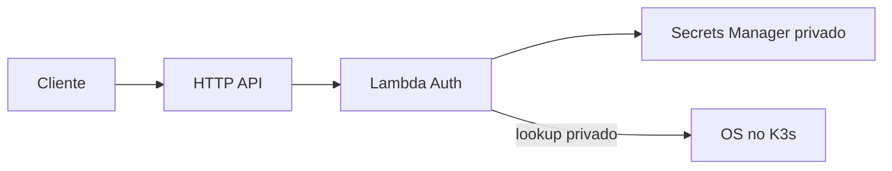

# oficina-auth-lambda

Function serverless .NET 10 para autenticação por CPF. Recebe `POST /auth/token` da HTTP API, valida o CPF, consulta a OS por rede privada e devolve JWT de cliente de 15 minutos. CPF não entra na URL, no token ou nos logs; cliente ausente/inativo e CPF inválido recebem 401.



## Executar e testar

Instale o SDK indicado em `global.json`. O handler recebe o evento HTTP API v2 como `Stream`; testes locais exercitam CPF, lookup e geração do JWT:

```powershell
dotnet test services/Oficina.Auth.Tests -c Release
./scripts/aws-demo/build-auth-lambda.ps1
```

O script gera um ZIP local ignorado pelo Git. As variáveis de runtime são `AUTH_LOOKUP_URL`, `AUTH_OS_SECRET_ARN`, `AUTH_JWT_ISSUER` e `AUTH_JWT_AUDIENCE`; o segredo contém `Auth__LookupToken` e `Jwt__Key` e é lido em runtime. A [API documentada](services/Oficina.Auth/README.md) é `POST /auth/token` com JSON `{"cpf":"52998224725"}`. Lambda não fornece Swagger; a rota e os contratos são exercitados nos testes.

## Deploy

`oficina-data-infra` cria o segredo da OS, `oficina-k8s-infra` cria VPC/endpoint privado, Lambda e HTTP API. O workflow `auth-ci` testa, empacota e, quando OIDC/variáveis estiverem configurados, atualiza somente o código da Function. Uma nova aplicação Terraform requer o ZIP inicial sincronizado com o commit para evitar regressão. Consulte a [arquitetura completa](docs/architecture-phase4.md). Nenhuma invocação AWS foi comprovada até o deploy autorizado.
