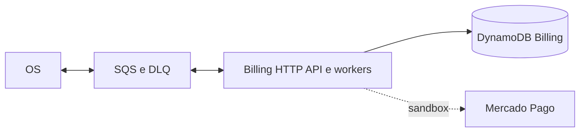

# oficina-billing

Serviço .NET 10 de orçamento, decisão do cliente, tentativa de pagamento e reconciliação/estorno. Possui tabela DynamoDB própria com escritas condicionais, Inbox/Outbox e IDs idempotentes. O adaptador Mercado Pago usa Orders de testes; sem credenciais externas, apenas testes com provedor simulado são comprovados.



## Executar e testar

Instale o SDK indicado em `global.json` e inicie DynamoDB Local na porta 8000. `appsettings.Development.json` usa essa URL e cria a tabela local se faltar:

```powershell
docker run --rm -p 8000:8000 amazon/dynamodb-local:latest
```

Em outro terminal:

```powershell
$env:ASPNETCORE_ENVIRONMENT = 'Development'
$env:ASPNETCORE_URLS = 'http://localhost:8080'
dotnet run --project services/Oficina.Billing
```

Acesse [Swagger local](http://localhost:8080/swagger) e [healthcheck](http://localhost:8080/health/ready). O grupo `/internal` exige `X-Internal-Token` e expõe orçamento, decisão e consultas de tentativa. `POST /webhooks/mercado-pago/orders` é usado quando o provedor de testes e assinatura estiverem configurados. O Swagger só é exposto em Development.

```powershell
dotnet test services/Oficina.Billing.Tests -c Release
docker build -f services/Oficina.Billing/Dockerfile -t oficina-billing:local .
kubectl kustomize k8s/services/billing
```

Os testes de integração usam DynamoDB Local e ElasticMQ com `BILLING_DYNAMO_ENDPOINT` e `MESSAGING_SQS_ENDPOINT`. O workflow `billing-ci` inicia esses emuladores, executa as duas suítes, exige cobertura de 80% e, com OIDC configurado, publica imagem ECR e solicita rollout K3s por SSM.

## Deploy

O overlay `k8s/services/billing` inclui Deployment, Service, ServiceAccount, HPA, ConfigMap e probes. `REPLACE_WITH_*` e Secrets são preenchidos pelo bootstrap; tokens Mercado Pago são externos ao Git. `oficina-data-infra` provê DynamoDB/filas e `oficina-k8s-infra` provê o cluster. Consulte a [arquitetura completa](docs/architecture-phase4.md) e a [reconciliação de estorno](docs/runbooks/refund-reconciliation.md). Nenhum deploy AWS nem pagamento real foi comprovado até a execução autorizada.
