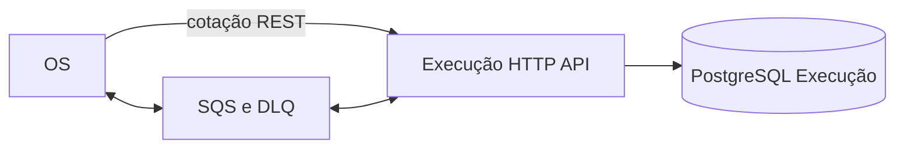

# oficina-execution

Serviço .NET 10 de catálogo, reserva de estoque e ciclo de reparo. Possui PostgreSQL `oficina_execution` na AWS e usa SQLite no desenvolvimento. Reservas são idempotentes e protegidas por transação/concorrência; eventos chegam e saem por SQS com Inbox/Outbox.



## Executar e testar

Instale o SDK indicado em `global.json`. `appsettings.Development.json` usa SQLite e token interno de demonstração:

```powershell
$env:ASPNETCORE_ENVIRONMENT = 'Development'
$env:ASPNETCORE_URLS = 'http://localhost:8080'
dotnet run --project services/Oficina.Execution
```

Em outro terminal, acesse [Swagger local](http://localhost:8080/swagger) e [healthcheck](http://localhost:8080/health/ready). O grupo `/internal` exige `X-Internal-Token`; inclui `POST /internal/catalog/quote`, reserva/liberação de estoque e conclusão/recusa de reparo. O Swagger só é exposto em Development.

```powershell
dotnet test services/Oficina.Execution.Tests -c Release
docker build -f services/Oficina.Execution/Dockerfile -t oficina-execution:local .
kubectl kustomize k8s/services/execution
```

Os testes PostgreSQL precisam de `EXECUTION_POSTGRES_CONNECTION_STRING`, `EXECUTION_OUTBOX_POSTGRES_CONNECTION_STRING` e `EXECUTION_WORKER_POSTGRES_CONNECTION_STRING` apontando para três databases isolados; o teste de worker também usa `MESSAGING_SQS_ENDPOINT` (ElasticMQ). O segundo database executa o cenário BDD de concorrência da Outbox. O workflow `execution-ci` inicia PostgreSQL e ElasticMQ, executa as duas suítes, incluindo Gherkin, exige cobertura de 80% sem migrations geradas e, com OIDC configurado, publica imagem ECR e solicita rollout K3s por SSM.

## Deploy

O overlay `k8s/services/execution` inclui Deployment, Service, ServiceAccount, HPA, ConfigMap e probes. O bootstrap da infraestrutura substitui `REPLACE_WITH_*` e cria Secrets/credenciais temporárias fora do Git. `oficina-data-infra` provê o banco e filas; `oficina-k8s-infra` provê o cluster. Consulte a [arquitetura completa](docs/architecture-phase4.md). Nenhum deploy AWS foi comprovado até a execução autorizada.
