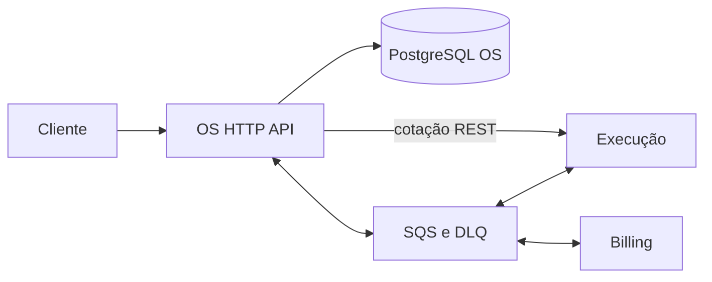

# oficina-os

API .NET 10 de clientes, veículos e ordens de serviço. A OS é a orquestradora da Saga: persiste o estado, publica comandos pela Outbox e aplica respostas pela Inbox. Execução fornece cotação/estoque/reparo; Billing cuida do orçamento e pagamento. O banco próprio é PostgreSQL `oficina_os` na AWS; SQLite é usado em desenvolvimento.



## Executar e testar

Instale o SDK indicado em `global.json`. Para desenvolvimento local, o projeto usa SQLite e configurações de `appsettings.Development.json`:

```powershell
$env:ASPNETCORE_ENVIRONMENT = 'Development'
$env:ASPNETCORE_URLS = 'http://localhost:8080'
dotnet run --project src/OficinaMvp.Api
```

Em outro terminal, acesse [Swagger local](http://localhost:8080/swagger) e [healthcheck](http://localhost:8080/health/ready). As rotas principais são `POST /api/work-orders`, `GET /api/work-orders/{id}/status` e `GET /api/client/work-orders/{id}` com JWT de cliente. Rotas administrativas usam JWT de administrador. O Swagger só é exposto em Development/Testing; não abra produção para obter a documentação.

```powershell
dotnet test tests/OficinaMvp.Domain.Tests -c Release
dotnet test tests/OficinaMvp.Integration.Tests -c Release
docker build -f src/OficinaMvp.Api/Dockerfile -t oficina-os:local .
kubectl kustomize k8s/services/os
```

O cenário BDD de concorrência da Outbox requer `OS_POSTGRES_CONNECTION_STRING` apontando para um schema PostgreSQL isolado. O workflow `os-ci` inicia PostgreSQL, executa as três suítes, incluindo Gherkin, e aplica o gate de 80% com `scripts/validate-os-coverage.py`. Em `main`, após configurar AWS OIDC, publica a imagem no ECR e solicita rollout K3s por SSM.

## Deploy

O overlay `k8s/services/os` inclui Deployment, Service, ServiceAccount, HPA, ConfigMap, NodePort privado de consulta da Lambda e probes. Valores `REPLACE_WITH_*` em `config.env` são preenchidos pelo bootstrap da infraestrutura; os Secrets de aplicação, AWS temporários e pull ECR são preparados fora do Git. O repositório `oficina-k8s-infra` provisiona o cluster e o `oficina-data-infra` provisiona o banco/filas. Consulte a [arquitetura completa](docs/architecture-phase4.md). Nenhum deploy AWS foi comprovado até a execução autorizada.
