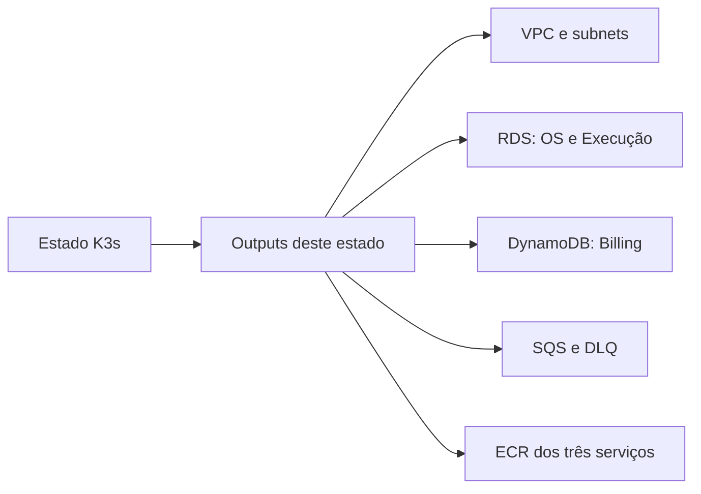

# oficina-data-infra

Estado Terraform separado para VPC/subnets, RDS PostgreSQL, DynamoDB, SQS/DLQ, ECR e entradas vazias de segredos. O módulo K3s lê somente seus outputs por `terraform_remote_state`; a ordem de criação é **data → K3s** e a remoção é **K3s → data**.



## Validação local

```powershell
terraform -chdir=infra/aws-data fmt -check
terraform -chdir=infra/aws-data init -backend=false
terraform -chdir=infra/aws-data validate
```

Para um `plan` real, configure o mesmo bucket S3 privado para os dois estados, com a chave `oficina-fiap-demo/data.tfstate`, versão e criptografia. Copie `backend.hcl.example` para `backend.hcl` (ignorado), autentique por perfil temporário/SSO e execute `terraform init -backend-config=backend.hcl` e `terraform plan -var='aws_region=REGIAO'`. Não execute `apply` antes de revisar o plano, custo e autorizar a criação dos recursos.

O workflow `data-infra-ci` sempre executa `fmt` e `validate`. O disparo manual com `deploy=true` gera um plano como artefato; o job de `apply` espera aprovação no ambiente GitHub `aws-demo`. São necessárias as variables `AWS_REGION`, `AWS_STATE_BUCKET` e `AWS_ROLE_ARN_INFRA_DATA`, além de uma role OIDC de bootstrap criada fora deste módulo. O mesmo ambiente precisa exigir revisores. Nenhum run remoto foi executado.

Este módulo não contém API. Swagger/Postman ficam nos repositórios dos serviços. A visão geral e a sequência da Saga estão em `docs/architecture-phase4.md` no repositório de origem.
