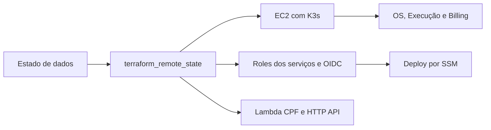

# oficina-k8s-infra

Estado Terraform separado para EC2/K3s, roles de workloads, OIDC dos serviços/Auth, SSM de deploy, bucket de assets, Lambda CPF e HTTP API. Lê o estado `oficina-data-infra` por `terraform_remote_state`, sem copiar recursos de banco para seu próprio state.



## Validação local

O ZIP inicial da Lambda deve existir em `infra/aws-k3s/artifacts/oficina-auth.zip` antes do `validate/plan`:

```powershell
./scripts/aws-demo/build-auth-lambda.ps1 -OutputPath infra/aws-k3s/artifacts/oficina-auth.zip
terraform -chdir=infra/aws-k3s fmt -check
terraform -chdir=infra/aws-k3s init -backend=false
terraform -chdir=infra/aws-k3s validate
```

Após aplicar **data** com autorização, copie `backend.hcl.example` para `backend.hcl` (ignorado), configure o mesmo bucket de state com chave `oficina-fiap-demo/k3s.tfstate`, autentique por perfil temporário/SSO e informe `data_state_bucket`, `aws_region` e `github_owner` no `plan`. `name_prefix` e região devem coincidir com o estado de dados. O workflow `k3s-infra-ci` valida sempre; o disparo manual com `deploy=true` gera artefato de plano e aguarda aprovação do ambiente `aws-demo` para aplicar. Configure `AWS_REGION`, `AWS_STATE_BUCKET`, `GITHUB_OWNER` e `AWS_ROLE_ARN_INFRA_K3S`, com role OIDC de bootstrap e revisores no ambiente. Nenhum run remoto foi executado.

O clone deste repositório inclui uma cópia do código Auth apenas para produzir o ZIP inicial; depois, o pipeline do repositório `oficina-auth-lambda` atualiza somente o código da Function. O pacote inicial de scripts/manifests usa os outputs consolidados deste estado. Esta infraestrutura de demonstração usa um nó e não oferece alta disponibilidade.

As APIs e Swagger ficam nos repositórios de serviços. Diagramas gerais e sequência estão em `docs/architecture-phase4.md` no repositório de origem.
